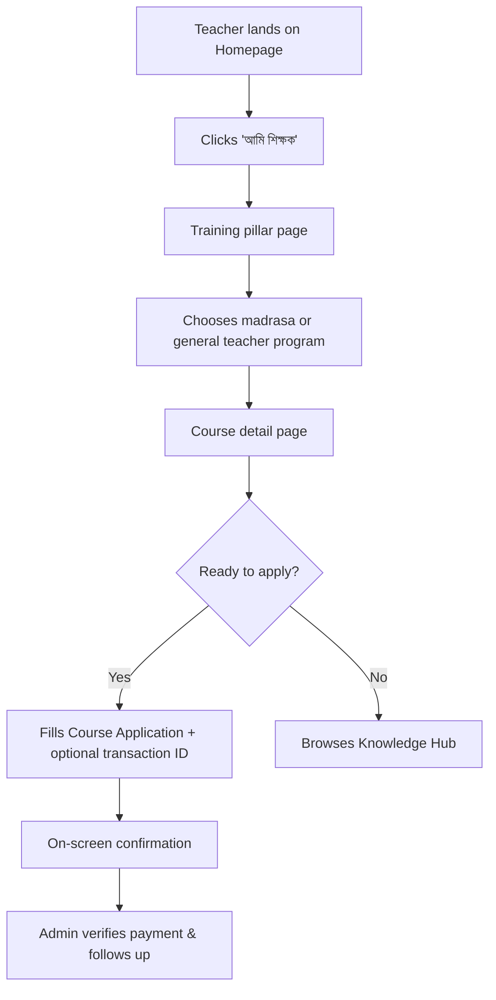
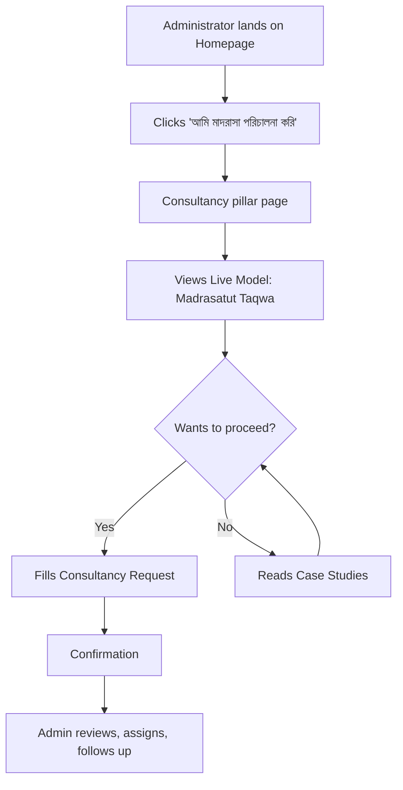
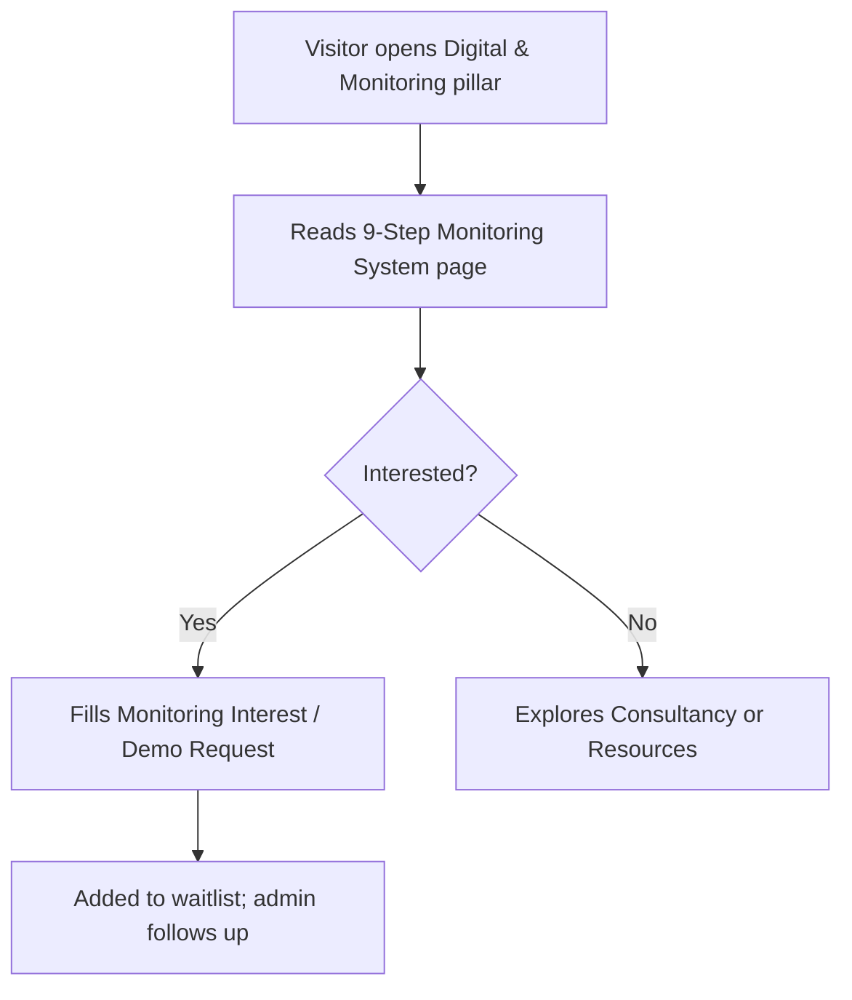
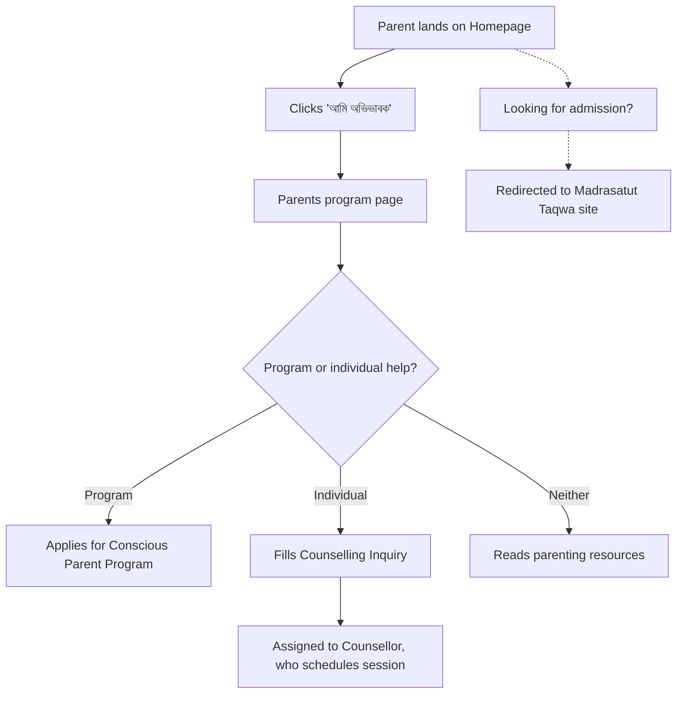
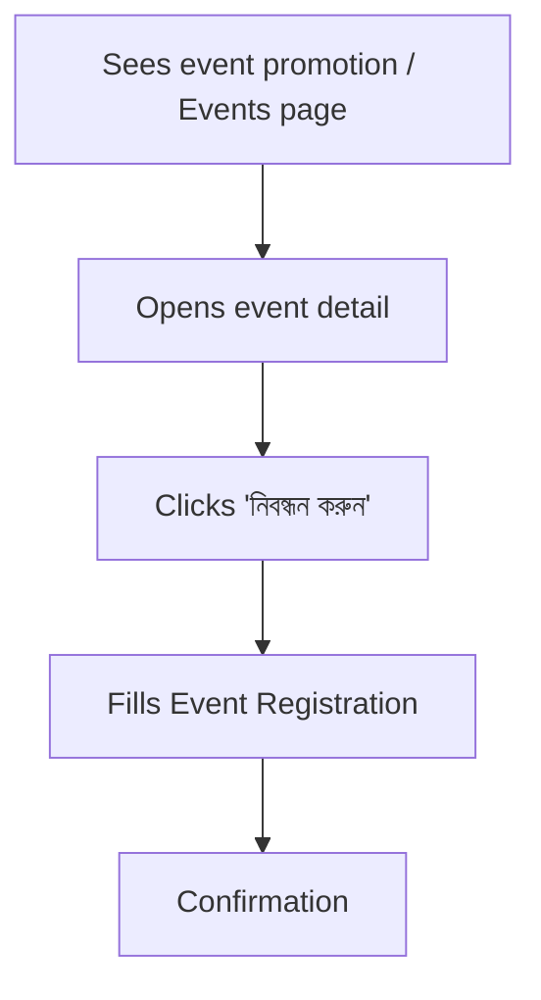
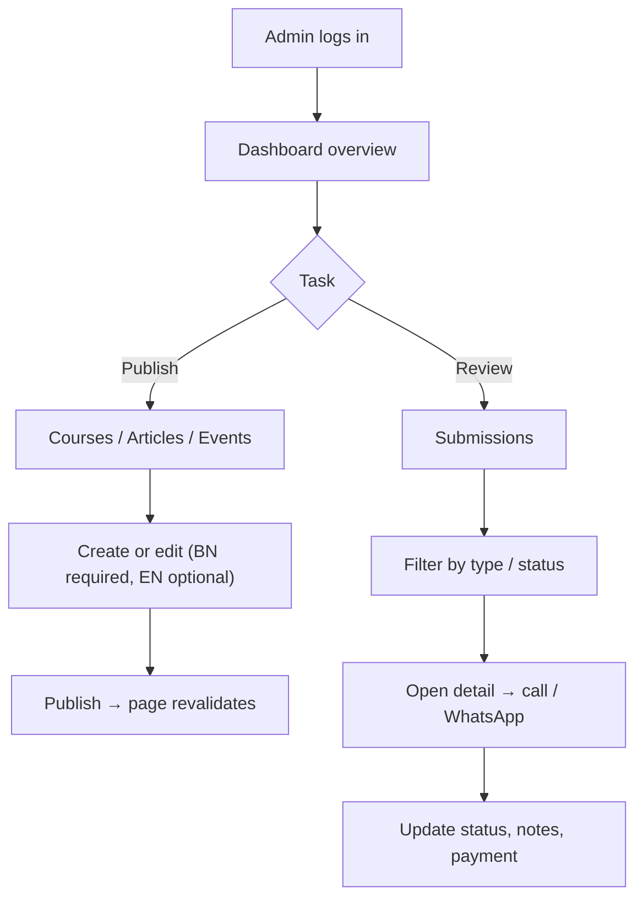

# Product Requirements Document (PRD)
## At-Taqwa Institute Digital Platform

**Version:** 1.1
**Date:** October 29, 2026
**Status:** Draft — Pending Stakeholder Review
**Tech Stack:** Next.js (App Router), TypeScript, Tailwind CSS, Supabase
**Primary Language:** Bengali (SolaimanLipi) | **Secondary Language:** English

---

## Changelog (v1.0 → v1.1)

| # | Change |
|---|---|
| 1 | Defined the boundary between **At-Taqwa Institute** (this site) and **Madrasatut Taqwa** (separate site) |
| 2 | Restructured 8 service categories into **3 core pillars**: Training & Courses, Consultancy & Institutional Development, Digital Education & Monitoring |
| 3 | Added missing programs: Conscious Parent Program, Psychological Training, Child Psychological Training, Teaching Proficiency for general teachers |
| 4 | Added **9-Step Student Monitoring System** introduction page and Monitoring Interest / Demo Request form to V1 |
| 5 | Added Madrasatut Taqwa as the Institute's **Live Model** and first case study |
| 6 | Replaced FID with **INP** in Core Web Vitals |
| 7 | Added Bengali search strategy (`pg_trgm`), English-only URL slugs, and i18n routing rules |
| 8 | Added font fallback, hosting/backup, rate limiting, and email provider decisions |
| 9 | Added manual payment (bKash/Nagad Transaction ID) and WhatsApp to V1 scope |
| 10 | Added a Counsellor role, child photo consent policy, phased timeline, and acceptance criteria |

---

## 1. Project Overview

### 1.1 What Is This?

The At-Taqwa Institute Digital Platform is a bilingual (Bengali/English) website that serves as the central digital presence for **At-Taqwa Institute**, an organization that works to build **system-based, sustainable, high-quality Islamic education** by combining modern management science with Islamic values.

The Institute works through three core pillars:

1. **Training & Courses (প্রশিক্ষণ ও কোর্স)**
2. **Consultancy & Institutional Development (পরামর্শ ও প্রাতিষ্ঠানিক উন্নয়ন)**
3. **Digital Education & Monitoring (ডিজিটাল শিক্ষা ও পর্যবেক্ষণ)**

### 1.2 Mission & Vision

| | |
|---|---|
| **Mission** | Build a system-based, sustainable, high-quality model for Hifzul Quran and madrasa education by combining modern management with Islamic values. |
| **Vision** | Move madrasa management from person-dependency to system-dependency, and make this model available to institutions across the country. |

### 1.3 Relationship with Madrasatut Taqwa

At-Taqwa Institute and **Madrasatut Taqwa** are related organizations with **separate websites**.

| At-Taqwa Institute (this platform) | Madrasatut Taqwa (separate site — out of scope) |
|---|---|
| Training & Courses | Hifzul Quran & residential madrasa |
| Consultancy & Institutional Development | Maktab for school students |
| Digital Education & Monitoring | Islamic school activities |
| Resources, Events, Case Studies | Student development activities |
| | Business activities |
| | Student admissions |

**How this platform presents Madrasatut Taqwa:**
- Shown as the Institute's **Live Model**: "What we teach, we implement in our own madrasa."
- A short introduction section on the About page and the Consultancy pillar page, with an outbound link to the Madrasatut Taqwa website.
- Used as the **first documented case study** (F6).
- Student admission inquiries are **not** handled here. Any admission-related visitor is redirected to the Madrasatut Taqwa site.

### 1.4 Problem Statement

At-Taqwa Institute currently lacks a unified digital platform to:

- Present its identity, mission, and three pillars professionally
- Let teachers, madrasa administrators, and parents discover and apply for programs
- Publish educational resources, research, and training materials
- Accept and manage training applications, consultation requests, and inquiries
- Showcase verifiable results, starting with Madrasatut Taqwa as a live model

### 1.5 Proposed Solution

A modern, responsive website built on Next.js + Supabase that functions as:

1. **Institutional Website** — Public pages presenting the three pillars, programs, team, and credibility markers
2. **Knowledge Hub** — A structured library of articles, research, guides, and downloadable materials
3. **Inquiry & Application System** — Structured forms stored in a database, with an admin review workflow
4. **Content Management System (CMS)** — An admin dashboard that lets authorized staff manage content and submissions without touching code

### 1.6 Success Metrics

| Metric | Target |
|---|---|
| Core Web Vitals (**LCP, INP, CLS**) | "Good" thresholds on mobile & desktop (LCP ≤ 2.5s, INP ≤ 200ms, CLS ≤ 0.1) |
| Accessibility | WCAG 2.1 AA on all public pages |
| Form submission success rate | > 99% (no silent data loss) |
| Admin content update turnaround | Staff can publish a new article or course within 10 minutes |
| SEO indexing | All public pages indexed in Google Search Console within 4 weeks of launch |
| Responsive design | Fully functional on viewports ≥ 320px |
| Admin response time | Every new submission gets a status change within 48 hours |

### 1.7 Brand Identity

| Element | Specification |
|---|---|
| Logo | Existing At-Taqwa Institute logo (unchanged) |
| Primary color | Navy Blue (sampled from logo) |
| Accent color | Gold (sampled from logo) |
| Background | White + light neutral tones |
| Bengali typeface | SolaimanLipi, with fallback `Noto Sans Bengali`, `Hind Siliguri`, `sans-serif` |
| English typeface | Inter (or compatible sans-serif) |
| Design direction | Modern Islamic Academic Premium |

### 1.8 Contact Information

| Channel | Value |
|---|---|
| Address | Bank Colony, Savar, Dhaka |
| Phone | 01612417120, 019995011 *(⚠️ second number looks incomplete; confirm before launch)* |
| WhatsApp | 01400189683 |
| Email | Attaqwainstitute69@gmail.com |
| Facebook | https://www.facebook.com/share/1RmdWwcFXq/ |
| Office hours | *[To be confirmed]* |

---

## 2. Target Users

### 2.1 Primary Users (Public Visitors)

| Persona | Who They Are | What They Need | Primary Pillar |
|---|---|---|---|
| **Madrasa Teachers** | Maktab, Nazera, Hifz, and Islamic studies teachers | Teaching Proficiency Program, methodology, classroom management | Training |
| **General Teachers** | School and general education teachers | Teaching proficiency program, classroom psychology | Training |
| **Madrasa Administrators** | Muhtamims, principals, directors, management teams | Institutional management training, consultancy, SOPs, monitoring systems | Consultancy, Digital & Monitoring |
| **Parents & Guardians** | Families concerned with children's education and upbringing | Conscious Parent Program, counselling, child psychology | Training |
| **Educational Institutions** | Madrasas and organizations as a whole | Curriculum development, assessments, system-level consultancy, monitoring system | Consultancy, Digital & Monitoring |
| **Researchers & Content Developers** | Individuals and organizations in Islamic education | Research publications, resources, collaboration | Digital & Monitoring (Knowledge Hub) |
| **Partners** | People and organizations seeking collaboration | Partnership proposals | Contact |

### 2.2 Internal Users (Admin Dashboard)

| Role | Permissions |
|---|---|
| **Administrator** | Full access: settings, user accounts, roles, all content, all submissions |
| **Content Editor** | Create/edit/publish articles, resources, courses, events, team profiles, case studies. **No** access to submissions or settings. |
| **Counsellor** *(new)* | Read and update **only** Parenting / Psychological counselling submissions assigned to them. No content or settings access. |

> Parenting and counselling inquiries can contain sensitive family and child information. They are visible only to Administrators and the assigned Counsellor.

---

## 3. Information Architecture

### 3.1 Main Navigation

```
Home | প্রশিক্ষণ ও কোর্স | পরামর্শ ও উন্নয়ন | ডিজিটাল ও পর্যবেক্ষণ | রিসোর্স | ইভেন্ট | আমাদের সম্পর্কে | যোগাযোগ
```

English: `Home | Training & Courses | Consultancy | Digital & Monitoring | Resources | Events | About | Contact`

### 3.2 Sitemap

```
/                                   Home
/training                           Pillar 1 overview
  /training/teachers                Teaching Proficiency Program (madrasa teachers)
  /training/general-teachers        Teaching Proficiency Program (general teachers)
  /training/administrators          Institutional Management & Leadership Training
  /training/parents                 Conscious Parent Program & Parent Counselling
  /training/psychology              Psychological Training
  /training/child-psychology        Child Psychological Training
/courses                            Course directory (filterable)
  /courses/[slug]                   Course detail + application
/consultancy                        Pillar 2 overview
  /consultancy/madrasa-management   Madrasa Management Consultancy
  /consultancy/education-system     Islamic Education System Development
  /consultancy/curriculum           Curriculum & Syllabus Development
  /consultancy/assessment           Institutional Assessment
  /consultancy/live-model           Madrasatut Taqwa — Live Model
/digital                            Pillar 3 overview
  /digital/monitoring-system        9-Step Student Monitoring System
  /digital/content                  Digital Content & Video
/resources                          Knowledge Hub
  /resources/[slug]                 Article / resource detail
/case-studies                       Results & case studies
  /case-studies/[slug]
/events                             Events & webinars
  /events/[slug]
/about                              About, team, values
  /about/team/[slug]
/contact                            Contact & inquiry forms
/faq  /privacy  /terms  /refund-policy  /child-protection  /accessibility
/search
/admin/*                            CMS (auth required, not indexed)
```

### 3.3 Language & URL Rules

- Routes are prefixed by locale: `/bn/...` (default) and `/en/...`. Visiting `/` redirects to `/bn`.
- **URL slugs are always English** (e.g. `/bn/training/parents`), so links stay readable when shared or printed. Content is in Bengali.
- Every content item has a Bengali version (required) and an English version (optional).
- If the English version is missing, the `/en` page shows the Bengali content with a notice: "This content is currently available in Bengali only."
- `hreflang` tags are added only when both language versions exist.

---

## 4. Core Features

### 4.1 Public Website

#### F1: Homepage
- Hero section with the institutional message and two CTAs: "আমাদের প্রোগ্রাম দেখুন" (Explore Programs) / "পরামর্শ নিন" (Request a Consultation)
- **Three pillar cards** (Training, Consultancy, Digital & Monitoring), each linked to its overview page
- Audience pathways:
  - "আমি শিক্ষক" (I am a teacher) → Training
  - "আমি মাদরাসা পরিচালনা করি" (I run a madrasa) → Consultancy
  - "আমি অভিভাবক" (I am a parent) → Training / Parents
  - "আমাদের প্রতিষ্ঠান উন্নয়ন করতে চাই" (We want to develop our institution) → Consultancy / Monitoring
- Featured programs (grid)
- Methodology section: Identify → Develop → Build → Implement → Measure → Improve
- **Live Model highlight:** Madrasatut Taqwa summary + link
- 9-Step Monitoring System teaser
- Team and trainer highlights
- Verified case studies / achievements
- Upcoming events
- Contact section with final CTA and WhatsApp button

#### F2: About Us
- Institutional story, mission, vision, values
- Educational approach: combining modern management science with Islamic ethics
- Team and trainer profiles (photo, bio, qualifications, specializations)
- Relationship with Madrasatut Taqwa (Live Model section + link)
- Quality and research standards
- Partnerships (when applicable)

#### F3: Pillar Pages

Each pillar has an **overview page** and **sub-pages**. Every sub-page contains:
- Description, purpose, methodology
- Target audience
- Scope and deliverables
- Expected outcomes
- Related courses / resources / case studies
- Inquiry or application CTA

**Pillar 1 — Training & Courses (প্রশিক্ষণ ও কোর্স)**

| Program | Audience |
|---|---|
| Teaching Proficiency Program (মাদরাসা শিক্ষক) | Maktab, Nazera, Hifz, Islamic studies teachers |
| Teaching Proficiency Program (সাধারণ শিক্ষক) | School / general teachers |
| Institutional Management & Leadership Training | Madrasa administrators and directors |
| Conscious Parent Program (সচেতন অভিভাবক) & Parent Counselling | Parents and guardians |
| Psychological Training | Teachers, administrators, parents |
| Child Psychological Training | Parents, teachers |

**Pillar 2 — Consultancy & Institutional Development (পরামর্শ ও প্রাতিষ্ঠানিক উন্নয়ন)**

| Service | Description |
|---|---|
| Madrasa Management Consultancy | Operational systems, SOPs, staff structure, management frameworks |
| Islamic Education System Development | System-level design for institutions |
| Curriculum & Syllabus Development | Curriculum design and review |
| Institutional Assessment | Diagnosis of current state and an improvement roadmap |
| Live Model: Madrasatut Taqwa | The Institute's own implementation, with link to its site |

**Pillar 3 — Digital Education & Monitoring (ডিজিটাল শিক্ষা ও পর্যবেক্ষণ)**

| Item | V1 Scope |
|---|---|
| 9-Step Student Monitoring System | **Introduction page** explaining each of the 9 steps, benefits for institutions, and who it is for. CTA: Monitoring Interest / Demo Request form. |
| Monitoring Software | **Not built in V1.** Shown as "Coming soon" with a waitlist via the form above. |
| Knowledge Hub | See F5 |
| Digital Content & Video | Embedded videos (YouTube) and presentations |

#### F4: Programs & Courses
- Course directory with filters (pillar, audience, format: online / offline / hybrid, status: open / upcoming / closed)
- Course detail page: description, syllabus, trainer, duration, format, fee, eligibility, batch dates, FAQ
- Application form per course (F10)
- Fee display with manual payment instructions (bKash / Nagad / bank)

#### F5: Resources & Knowledge Hub
- Articles (categories + tags)
- Research and publications
- Teacher guides, madrasa management resources, parenting materials, Hifz/Quran teaching resources
- Downloadable templates, SOPs, PDFs
- Video and presentation embeds
- Search, filters, related content

#### F6: Results & Case Studies
- Problem → Intervention → Outcome format
- **First case study: Madrasatut Taqwa**
- Before/after comparisons (evidence-backed only)
- Verified testimonials (published with written permission)

#### F7: Events & Webinars
- Upcoming seminars, workshops, free orientations
- List + calendar view
- Event detail: description, date/time, location or online link, speakers
- Registration form
- Past events archive with linked resources

#### F8: Contact
- Contact information (§1.8) and Google Map embed
- General contact form
- Links to pillar-specific inquiry forms
- **WhatsApp click-to-chat button** (`https://wa.me/8801619995011`), shown site-wide on mobile
- Note directing admission inquiries to the Madrasatut Taqwa site

#### F9: Supporting Pages
- Site-wide search
- FAQ
- Privacy Policy
- Terms of Service
- Refund & Cancellation Policy
- Data Handling & Child Protection Policy
- Accessibility Statement
- XML sitemap, `robots.txt`
- Custom 404 page (Bengali + English)

---

### 4.2 Forms & Application System

#### F10: Forms

| Form | Pillar | Key Fields |
|---|---|---|
| General Contact | — | Name, phone, email (optional), subject, message |
| Course / Training Application | Training | Name, phone, email, course, batch, institution, role, experience, payment method, **transaction ID** (optional) |
| Parenting / Counselling Inquiry | Training | Parent name, phone, child age range, topic, preferred contact time, message. **Sensitive.** |
| Institutional Consultancy Request | Consultancy | Institution name, location, contact person, role, number of students/teachers, service needed, current challenges |
| **Monitoring System Interest / Demo Request** *(new)* | Digital | Institution name, contact person, phone, number of students, current tracking method, interest level |
| Research / Collaboration Proposal | — | Name, organization, proposal summary, attachment (PDF, ≤ 5MB) |
| Event Registration | Events | Name, phone, email, event, institution (optional) |
| Newsletter Subscription | — | Email or phone |

- **Phone number is required on every form; email is optional.** Phone is the main contact channel in Bangladesh. Validate it as a Bangladeshi mobile number (`01[3-9]XXXXXXXX`).
- Each form has a consent checkbox linking to the Privacy Policy.

#### F11: Application Workflow

```
Submission → Server-side validation & sanitization → Spam check (honeypot + rate limit)
→ Save to Supabase → Email notification to admin → On-screen confirmation to user
→ Admin review → Status update → Follow-up (phone / WhatsApp / email)
```

- Statuses: **New → In Review → Responded → Closed** (plus **Spam**)
- Payment status for course applications (manually verified): **Unpaid → Pending Verification → Paid → Refunded**
- Confirmation email is sent to the user only when an email address is provided.

---

### 4.3 Admin Dashboard (CMS)

#### F12: Dashboard Overview
- Counts: new submissions (by type), pending review, overdue (> 48h without status change), published content
- Recent submissions list
- Quick actions: New article, New course, New event

#### F13: Content Management

| Module | Capabilities |
|---|---|
| Pillars & Sub-pages | Edit content, reorder, publish/unpublish |
| Courses & Batches | Manage courses, batches, fees, syllabus, trainer assignment, open/close applications |
| Articles & Publications | Draft, edit, schedule, publish, archive |
| Resources & Downloads | Upload (PDF/DOCX/XLSX, ≤ 20MB), categorize, manage |
| Events | Create, manage registrations, archive |
| Team Profiles | Add/edit trainer and staff profiles |
| Case Studies & Testimonials | Publish verified case studies and approved testimonials |

All content has Bengali (required) and English (optional) fields.

#### F14: Submission Management
- View submissions by type and status
- Detail view, status update, internal notes, assign to staff member
- Verify manual payments (mark transaction ID as verified)
- One-click WhatsApp / call link from the submission detail
- CSV export (Administrator only)

#### F15: Settings & Users
- Manage users and roles (Administrator, Content Editor, Counsellor)
- Site settings: contact info, social links, WhatsApp number, announcement banner, Madrasatut Taqwa site URL

---

### 4.4 Technical & Cross-Cutting Requirements

#### F16: SEO
- Unique `<title>` and `<meta description>` per page and per locale
- English slugs, canonical URLs, `hreflang` where both languages exist
- Logical H1–H6 hierarchy
- Auto-generated XML sitemap; `robots.txt` (disallow `/admin`)
- Open Graph and social sharing metadata
- Structured data: `EducationalOrganization`, `Course`, `Event`, `Article`
- Image optimization with descriptive `alt` text
- Google Search Console setup

#### F17: Performance
- Next.js `<Image>` optimization
- Font: self-host SolaimanLipi, subset to the Bengali + Latin glyphs in use, `font-display: swap`, preload the regular weight only
- SSG/ISR for public pages; revalidate on CMS publish (on-demand revalidation)
- Server Components by default; minimal client-side JavaScript
- Monitor Core Web Vitals (LCP, INP, CLS) via Vercel Analytics or Search Console

#### F18: Security
- HTTPS enforced
- All secrets in environment variables; Supabase service-role key used only on the server
- Supabase Auth for admin login
- Row Level Security (RLS) on **all** tables; public role can only `INSERT` into submission tables and `SELECT` published content
- Server-side validation (Zod) on every form
- Server Actions for form handling (built-in origin check for CSRF protection)
- File uploads: type allow-list, size limits, private storage bucket for submission attachments
- **Rate limiting:** Upstash Redis (or equivalent): max 5 submissions per IP per 10 minutes per form
- Error logging (e.g. Sentry)

#### F19: Accessibility
- Semantic HTML5, consistent headings
- Keyboard navigation with visible focus indicators
- WCAG AA color contrast (check Gold-on-White text especially)
- Accessible form labels, error messages, and ARIA attributes
- Alt text on all meaningful images
- Bengali body text ≥ 16px, line-height ≥ 1.7

#### F20: Responsive Design
- Mobile-first
- Breakpoints: 320px+, 768px+, 1024px+, 1280px+
- Tap targets ≥ 44px
- Hamburger navigation on mobile; floating WhatsApp button

#### F21: Search (Bengali-aware) *(new)*
- Postgres full-text search does not support Bengali stemming, so use the **`pg_trgm`** extension (trigram similarity) on title and body fields, with a GIN index.
- Search covers courses, articles, resources, events, and case studies.
- Results are filtered by locale and published status.

#### F22: Hosting, Email & Backup *(new)*

| Concern | Decision |
|---|---|
| Hosting | Vercel (Pro recommended for commercial use) |
| Database / Auth / Storage | Supabase **Pro plan**. The free plan pauses inactive projects, which is unacceptable for production. |
| Backups | Supabase daily backups + monthly manual export kept off-platform |
| Transactional email | Resend (or equivalent), with a verified sending domain |
| Domain | *[To be confirmed: e.g. attaqwainstitute.org]* |
| Analytics | Vercel Analytics or Google Analytics 4 + Google Search Console |

---

## 5. Data & Privacy Policies

- **Child photos:** No photo in which a child is identifiable is published without **written parental consent**. Consent records are kept by the Administrator.
- **Testimonials:** Published only with written permission; the person can ask for removal at any time.
- **Counselling data:** Visible only to Administrators and the assigned Counsellor; excluded from CSV export by editors.
- **Retention:** Closed submissions older than 2 years are archived or deleted (*policy to be confirmed by stakeholders*).
- **No selling or sharing** of personal data with third parties.

---

## 6. User Flows

### 6.1 Teacher Seeking Training



### 6.2 Madrasa Administrator Requesting Consultancy



### 6.3 Institution Interested in the Monitoring System



### 6.4 Parent Seeking Guidance



### 6.5 Visitor Registering for an Event



### 6.6 Admin Managing Content & Submissions



---

## 7. Acceptance Criteria (V1 Launch)

- [ ] All pages in the sitemap (§3.2) exist in Bengali; English exists for at least Home, About, the three pillar overviews, and Contact
- [ ] All 8 forms submit successfully, save to Supabase, and trigger an admin email
- [ ] Submissions with invalid phone numbers or honeypot content are rejected server-side
- [ ] Rate limit blocks the 6th submission from one IP within 10 minutes
- [ ] RLS verified: an anonymous client cannot read any submission row
- [ ] Content Editor cannot see submissions; Counsellor sees only assigned counselling submissions
- [ ] An editor can publish a new article in ≤ 10 minutes and it appears live without redeploy
- [ ] Bengali search returns relevant results for partial words
- [ ] Lighthouse (mobile): Performance ≥ 90, Accessibility ≥ 95, SEO ≥ 95 on Home and one course page
- [ ] Site works at 320px width with no horizontal scroll
- [ ] Links to the Madrasatut Taqwa site work from Home, About, Consultancy, and Contact
- [ ] Privacy, Terms, Refund, and Child Protection pages are published

---

## 8. Phased Timeline (Proposed)

| Phase | Duration | Deliverables |
|---|---|---|
| **0. Content & Design** | 2 weeks | Final copy for pillars and programs, team photos/bios, 9-step system text, UI design (Home, pillar, course, form pages) |
| **1. Foundation** | 2 weeks | Next.js setup, i18n routing, design system, Supabase schema + RLS, auth |
| **2. Public Site** | 3 weeks | Home, About, pillar pages, courses, resources, events, case studies, supporting pages |
| **3. Forms & CMS** | 3 weeks | All forms, workflow, admin dashboard, content modules, submission management |
| **4. QA & Launch** | 1–2 weeks | Acceptance criteria testing, SEO setup, content entry, launch |

**Total: ~11–12 weeks.** The main risk is content readiness (Phase 0), not development.

---

## 9. Out of Scope (V1)

| Item | Reason |
|---|---|
| **All Madrasatut Taqwa content** (Hifz, residential madrasa, maktab, Islamic school, student development, business, admissions) | Separate website. This platform only links to it. |
| **Monitoring Software (9-step system as an app)** | Separate product with sensitive child data and multi-role access. V1 includes only the introduction page and waitlist. The architecture should support it later. |
| **Full LMS** | Needs separate design, video hosting, progress tracking, assessments |
| **Video hosting** | Use YouTube embeds in V1; a dedicated provider can be added later |
| **Automated online payments** (SSLCommerz, bKash API) | V1 uses manual payment + transaction ID verification |
| **Certificate issuance & verification** | Depends on LMS |
| **Native mobile apps** | The responsive site serves mobile users |
| **Multi-institution client portals** | Future phase after consultancy workflows are proven |
| **Automated WhatsApp / SMS messaging** | V1 has click-to-chat only; automation after cost approval |
| **Complex automated workflows / drip emails** | Manual review in V1 |
| **Advanced analytics** | Basic analytics only |
| **Languages beyond Bengali/English** | Future consideration |
| **E-commerce** | Not in V1 |

---

## 10. Open Questions

| # | Question | Owner |
|---|---|---|
| 1 | Confirm the second phone number (019995011 looks incomplete) | Institute |
| 2 | Domain name for the Institute site | Institute |
| 3 | Madrasatut Taqwa site URL | Institute |
| 4 | Final text for the 9 steps of the monitoring system | Institute |
| 5 | Course fees and refund policy terms | Institute |
| 6 | Office hours | Institute |
| 7 | Establishment year, number of trained teachers / institutions, other verifiable achievements for the homepage | Institute |
| 8 | Is newsletter subscription needed in V1? | Institute |
| 9 | Submission data retention period | Institute |

---

> [!IMPORTANT]
> This PRD covers the **V1 release of the At-Taqwa Institute site only**. Madrasatut Taqwa has its own website and requirements. The Next.js + Supabase architecture is chosen so the 9-Step Monitoring System, LMS, and multi-institution portals can be added later without a rewrite.

---

**Prepared for:** At-Taqwa Institute
**Document Status:** Draft v1.1 — Pending Stakeholder Review & Approval
