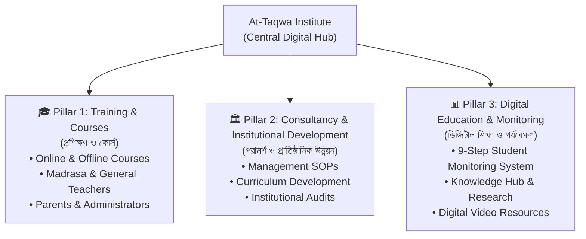
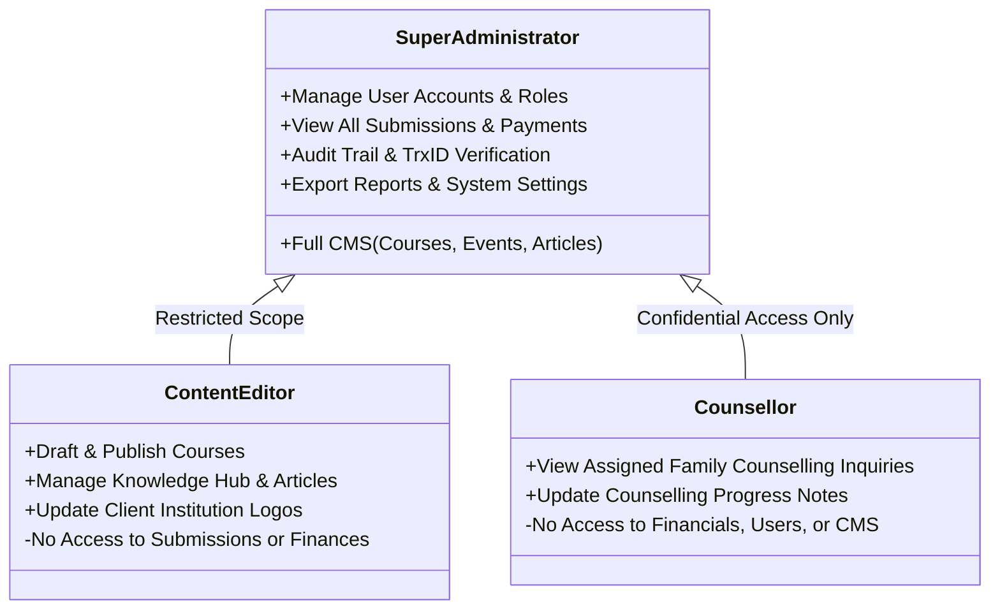
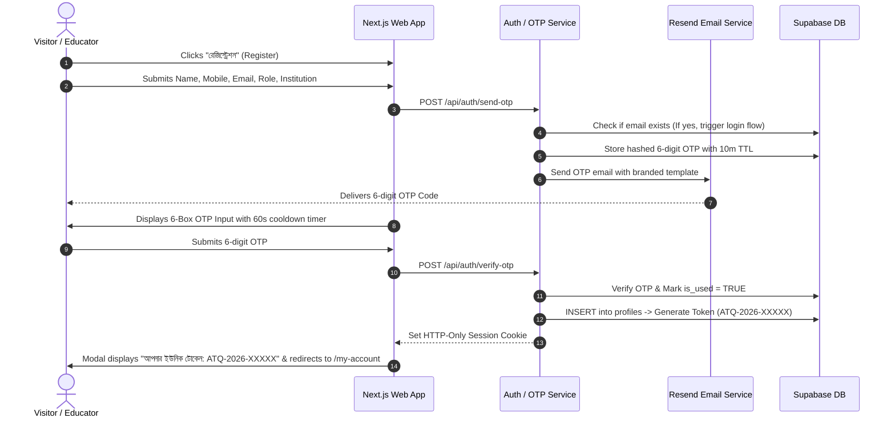
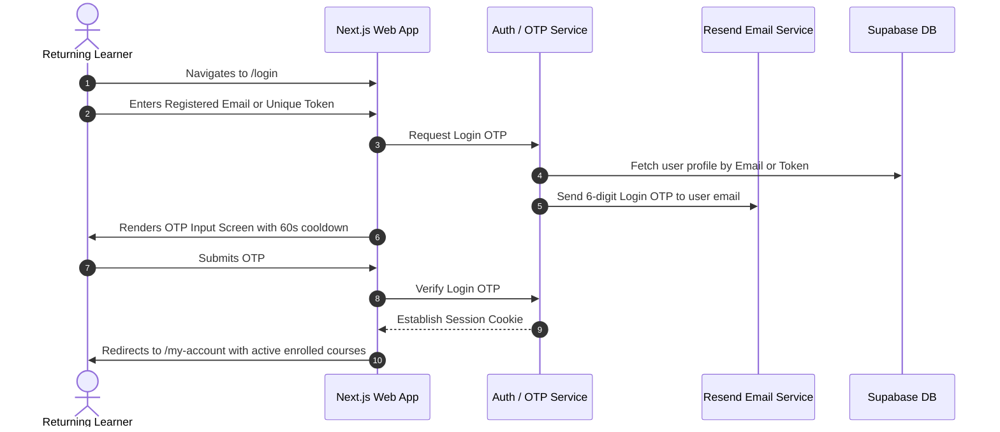
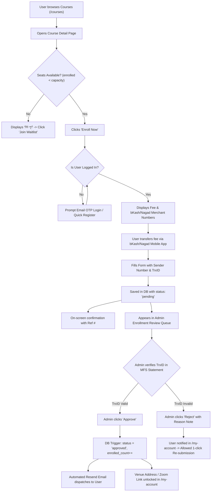
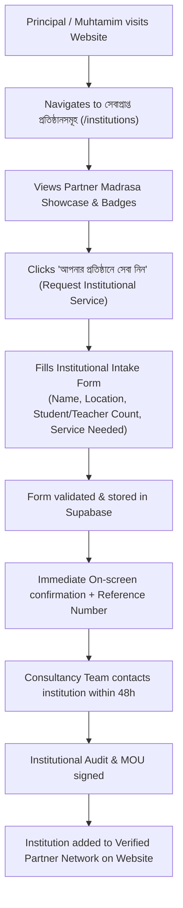
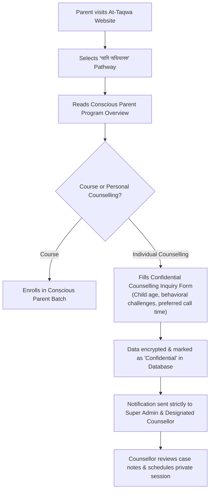
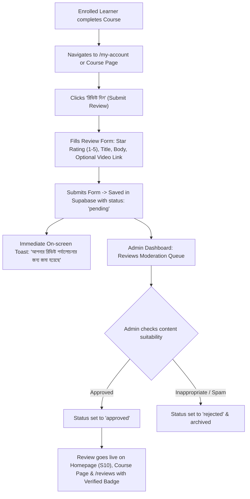

# Product Requirements Document (PRD)
## At-Taqwa Institute Digital Platform

**Version:** 1.3 (Production-Ready Architecture)  
**Date:** October 29, 2026  
**Status:** Approved for Implementation  
**Tech Stack:** Next.js 16 (App Router), React 19, TypeScript, Tailwind CSS v4, Framer Motion | Express.js REST API | MongoDB Atlas (Mongoose)  
**Primary Language:** Bengali (SolaimanLipi) | **Secondary Language:** English  

---

## Changelog (v1.2 → v1.3)

| # | Architecture Upgrade | Technical Implementation |
|---|---|---|
| 1 | **Passwordless Auth System** | No complex passwords. Both registration and returning user logins use 6-digit Email OTP. |
| 2 | **Standardized DB Schema** | Concrete Supabase tables defined: `profiles` (with unique `token`), `courses`, `batches`, `enrollments`, `institutions`, `counselling_requests`, `otps`. |
| 3 | **Batch Seat Capacity & Over-booking** | Added `seat_capacity` & `enrolled_count` per batch with auto-switch to "Houseful / Waitlist". Re-submission flow for rejected TrxIDs. |
| 4 | **OTP Abuse Prevention** | 60-second cooldown timer, disabled resend state, rate limit (max 3 OTPs/15m), and 3-attempt lock. |
| 5 | **Post-Approval Event Trigger** | Backend webhook/trigger automatically delivers transactional email and unlocks online Zoom links / offline classroom venue details in `/my-account`. |
| 6 | **Dynamic Open Graph Images** | Automated social preview generator using `@vercel/og` for viral WhatsApp and Facebook sharing. |
| 7 | **Zero-CLS Font Optimization** | Local WOFF2 SolaimanLipi subsetted to Bengali + Latin glyphs via `next/font/local` with `display: swap`. |
| 8 | **Dedicated Review & Rating Engine** | Verified multi-category reviews (`/reviews`), star ratings, video reviews, fake-review guard via Student Tokens, and admin moderation workflow. |

---

## 1. Project Overview

### 1.1 Executive Summary
The **At-Taqwa Institute Digital Platform** is a bilingual (Bengali-first/English), dynamic, scrolling educational training website and management system. It serves as the digital headquarters for **At-Taqwa Institute** (Established: 2019, Savar, Dhaka), an educational institution dedicated to modernizing Islamic education and madrasa management in Bangladesh by harmonizing **modern management science with Islamic ethical values**.

The platform is designed to achieve two major functions:
1. **Dynamic Institutional & Course Showcase Website:** A long-scrolling, interactive single-page public experience featuring smooth scroll navigation, scroll-triggered animations (Framer Motion), interactive course exploration (online & offline), and an institutional client showcase.
2. **Course Enrollment & Verification Engine:** A lightweight, secure user management system where students, teachers, and parents register with their profile, complete **Email OTP verification**, receive a **Unique User Token (User ID)**, enroll in courses with manual mobile financial services (bKash/Nagad) payment verification, and track their applications.

---

### 1.2 The Core Problem Statement
Madrasas and Islamic educational institutions in Bangladesh traditionally face severe person-dependency, lack of standardized standard operating procedures (SOPs), and absence of systematic pedagogical training for educators. Concurrently, At-Taqwa Institute previously lacked a centralized digital infrastructure to:
- Present its catalog of **online and offline courses** to educators and parents across the country.
- Provide a frictionless registration and **Email OTP verification** process for course participants.
- Issue and manage **unique tokens** for verified applicants to track their academic journeys.
- Showcase its growing network of **partner institutions and client madrasas** that implement At-Taqwa’s management SOPs and monitoring models.
- Channel institutional consultancy inquiries and parental counselling safely and systematically.

---

### 1.3 Mission, Vision & Strategic Objectives

| Attribute | Definition |
|---|---|
| **Mission** | Build a system-based, sustainable, high-quality model for Hifzul Quran, maktab, and Islamic general education by fusing modern management principles with timeless Islamic values. |
| **Vision** | Transition madrasa management from **person-dependency to system-dependency**, scaling this model to hundreds of educational institutions nationwide. |
| **Primary Goal** | Launch a high-performance web platform that drives course enrollments, automates verification via OTP, showcases client institutions, and facilitates institutional consultancy. |

---

### 1.4 Three Core Pillars of At-Taqwa Institute



---

### 1.5 Relationship with Madrasatut Taqwa (Live Model)
At-Taqwa Institute and **Madrasatut Taqwa** are sister initiatives with strict operational separation:
- **At-Taqwa Institute (This Platform):** Focuses on teacher training, institutional consultancy, course enrollment, parental education, research, and institutional monitoring frameworks.
- **Madrasatut Taqwa (Separate Platform — Out of Scope):** Residential Hifz madrasa, maktab for school students, academic admissions, and daily madrasa student affairs.
- **Integration Role:** Madrasatut Taqwa is presented on this platform solely as the Institute’s **"Live Model"** (*"What we teach, we implement in our own live institution"*), serving as Case Study #1. All madrasa student admission inquiries are redirected to the external Madrasatut Taqwa website.

---

### 1.6 Visual Identity, Colors & Design Direction

The UI/UX theme is directly derived from the official **At-Taqwa Institute Logo** (open book, sunrise rays, gold ribbon, and navy medallion):

| Palette Token | Color Name | Hex Code | Role in Interface |
|---|---|---|---|
| `primary-dark` | **Deep Navy** | `#0F1A2E` | Deep backgrounds, footer base, contrast text |
| `primary` | **Navy Blue** | `#1B2A4A` | Main navbar, headers, dark section cards |
| `primary-light` | **Royal Blue** | `#2C4A7B` | Secondary accents, active link indicators |
| `accent-orange` | **Sunrise Orange** | `#E8912A` | Logo sun rays motif, badge accents, notification dots |
| `accent-gold` | **Gold Yellow** | `#D4A843` | Primary CTAs, border highlights, active icons |
| `accent-gold-light`| **Bright Gold** | `#F0C75E` | Gradient midpoints, hover glow shadows |
| `neutral-sky` | **Light Sky** | `#A8D8EA` | Card tint borders, subtle badge backgrounds |
| `neutral-light` | **Cream White** | `#FDF8EF` | Light section backgrounds, page body canvas |

#### Core Gradients
- **Hero & Dark Sections:** `linear-gradient(135deg, #0F1A2E 0%, #1B2A4A 45%, #2C4A7B 100%)`
- **Gold CTA Buttons & Accents:** `linear-gradient(135deg, #D4A843 0%, #F0C75E 50%, #D4A843 100%)`
- **Sunrise Accent Gradient:** `linear-gradient(180deg, #E8912A 0%, #D4A843 50%, #F0C75E 100%)`
- **Card Background:** `linear-gradient(180deg, #FFFFFF 0%, #FDF8EF 100%)`

---

### 1.7 Typography & Zero-CLS Performance Optimization
- **Primary Bengali Font:** SolaimanLipi, converted to modern **WOFF2** format and self-hosted locally in `/public/fonts/`.
- **Optimization Strategy:** Loaded via `next/font/local` using `display: swap`. Glyph set is strictly subsetted to Bengali (U+0980–U+09FF) and Latin (U+0000–U+007F), reducing font payload from ~1.6MB to <80KB.
- **English Font:** Inter (`next/font/google`) with automatic subsetting.
- **Core Web Vitals Guarantee:** Eliminates Flash of Invisible Text (FOIT) and enforces Cumulative Layout Shift (CLS) ≤ 0.05.

---

## 2. Target Users

### 2.1 Primary Public Users (Learners & Clients)

| User Persona | Profile & Demographics | Primary Needs & Pain Points | Primary Platform Touchpoints |
|---|---|---|---|
| **Madrasa Teachers** | Maktab, Nazera, Hifz, and Kitab division instructors across Bangladesh. | Wants structured pedagogy, Quran recitation correction methods, and student psychology training. | Course Catalog (Teaching Proficiency), Registration, Student Token, Course Detail. |
| **General School Teachers** | Teachers from English/Bangla medium schools and general Islamic schools. | Wants classroom management skills, child behavioral guidance, and moral education techniques. | General Teacher Training Programs, Knowledge Hub, Downloadable Guides. |
| **Madrasa Administrators (Muhtamims / Principals)** | Founders, principals, and administrative directors of madrasas. | Seeks institutional transformation, financial/administrative SOPs, student retention solutions. | Institutional Consultancy, 9-Step Monitoring Teaser, Client Institutions Showcase. |
| **Client Educational Institutions** | Madrasas and schools seeking institutional partnership or systemic overhaul. | Requires end-to-end institution audits, faculty training packages, and continuous monitoring. | `/institutions` directory, Institutional Consultation Request Form. |
| **Parents & Guardians** | Modern parents conscious about their children's deen, tarbiyah, and mental wellbeing. | Requires practical guidance on child screen addiction, adolescence, and balanced upbringing. | Conscious Parent Program, Confidential Counselling Request Form. |
| **Researchers & Academics** | Islamic scholars, educators, and curriculum researchers. | Seeks research papers, modern madrasa models, and educational statistics. | Knowledge Hub, Publications, Research Proposal Form. |

---

### 2.2 Internal Users (Administrative Dashboard Roles)



---

## 3. Core Features & System Architecture

### 3.1 Public Scrolling Experience (13 Homepage Sections)

```
┌────────────────────────────────────────────────────────────────────────┐
│ 🔵 STICKY NAVBAR (Glass-morphism blur, Logo, Links, Token / Auth CTA)  │
├────────────────────────────────────────────────────────────────────────┤
│ ✦ S1: HERO SECTION (Sunrise rays animation, Navy gradient, Gold CTAs)  │
├────────────────────────────────────────────────────────────────────────┤
│ ✦ S2: AUDIENCE PATHWAYS (Interactive cards: Teacher, Admin, Parent)    │
├────────────────────────────────────────────────────────────────────────┤
│ ✦ S3: THREE PILLARS (Training, Consultancy, Digital & Monitoring)      │
├────────────────────────────────────────────────────────────────────────┤
│ ✦ S4: FEATURED COURSES (Online & Offline carousel, Filterable tabs)    │
├────────────────────────────────────────────────────────────────────────┤
│ ✦ S5: METHODOLOGY (Identify → Develop → Build → Implement → Evaluate)  │
├────────────────────────────────────────────────────────────────────────┤
│ ✦ S6: STATS COUNTERS (Animated numbers: Teachers, Institutions, Years) │
├────────────────────────────────────────────────────────────────────────┤
│ ✦ S7: LIVE MODEL SHOWCASE (Madrasatut Taqwa live case breakdown)       │
├────────────────────────────────────────────────────────────────────────┤
│ ✦ S8: সেবাপ্রাপ্ত প্রতিষ্ঠানসমূহ (Partner & Client Institutions Network)│
├────────────────────────────────────────────────────────────────────────┤
│ ✦ S9: 9-STEP STUDENT MONITORING SYSTEM (Interactive teaser infographic)│
├────────────────────────────────────────────────────────────────────────┤
│ ✦ S10: শিক্ষার্থী ও প্রতিষ্ঠান প্রধানদের রিভিউ ও রেটিং (Reviews & Ratings)│
│   • ক্যাটাগরি ট্যাব: সব | কোর্স রিভিউ | প্রাতিষ্ঠানিক সেবা | অভিভাবক রিভিউ│
│   • ৫-স্টার রেটিং ব্রেকডাউন (গড় রেটিং ৪.৯/৫ ⭐)                        │
│   • ব্যাজ: "ভেরিফাইড শিক্ষার্থী" (Verified Token) / "ভেরিফাইড মুহতামিম" │
│   • ভিডিও প্রশংসাপত্র (Video Reviews) ও "রিভিউ দিন" সাবমিশন বাটন       │
├────────────────────────────────────────────────────────────────────────┤
│ ✦ S11: TRAINERS & LEADERSHIP TEAM (Circular badge profiles)            │
├────────────────────────────────────────────────────────────────────────┤
│ ✦ S12: UPCOMING EVENTS & WEBINARS (Registration date badges)           │
├────────────────────────────────────────────────────────────────────────┤
│ ✦ S13: FINAL CTA & CONTACT (WhatsApp floating button, Savar map, Form) │
├────────────────────────────────────────────────────────────────────────┤
│ 🔵 FOOTER (Navigation directory, Social links, Copyright, Est. 2019)   │
└────────────────────────────────────────────────────────────────────────┘
```

---

### 3.2 Passwordless Authentication & Verification Architecture

To minimize user friction, **no complex password management is required**. Both account registration and returning user logins are handled via secure **Email OTP (One-Time Password)**.

#### 1. Registration Flow:
- User submits: `full_name`, `phone` (`01[3-9]XXXXXXXX`), `email`, `role`, and `institution`.
- If email is already registered, system alerts user and routes to passwordless login.
- System sends 6-digit numeric OTP via Resend API.
- User enters OTP in 6-box input.
- System creates record in `profiles` and auto-generates **Unique User Token** (`ATQ-YYYY-[RANDOM5]`, e.g., `ATQ-2026-87K2M`).

#### 2. Returning User Login Flow:
- User visits `/login` and provides either their **Registered Email** or **Unique Token**.
- System generates a 6-digit OTP sent to their verified email address.
- Upon OTP verification, system sets an HTTP-only authenticated session cookie and redirects user to `/my-account`.

#### 3. OTP Abuse Prevention & Rate Limiting:
- **60-Second Cooldown Timer:** A visual countdown timer disables the "Resend OTP" button for 60 seconds after dispatch.
- **Request Rate Limit:** Max 3 OTP generation requests per email/IP per 15-minute window.
- **Verification Attempt Limit:** 3 incorrect OTP entries automatically invalidate the current token, requiring a new code.
- **TTL:** All OTPs expire strictly in 10 minutes.

---

### 3.3 Database Schema & Data Models (Supabase / PostgreSQL)

```sql
-- 1. PROFILES (Registered Users & Tokens)
CREATE TABLE profiles (
    id UUID PRIMARY KEY DEFAULT gen_random_uuid(),
    token VARCHAR(20) UNIQUE NOT NULL, -- e.g. ATQ-2026-XXXXX
    full_name VARCHAR(150) NOT NULL,
    phone VARCHAR(20) NOT NULL,
    email VARCHAR(150) UNIQUE NOT NULL,
    role VARCHAR(50) NOT NULL, -- 'madrasa_teacher', 'general_teacher', 'admin', 'parent', 'student'
    institution VARCHAR(200),
    created_at TIMESTAMPTZ DEFAULT NOW(),
    updated_at TIMESTAMPTZ DEFAULT NOW()
);

-- 2. COURSES (Catalog)
CREATE TABLE courses (
    id UUID PRIMARY KEY DEFAULT gen_random_uuid(),
    slug VARCHAR(100) UNIQUE NOT NULL,
    title_bn VARCHAR(250) NOT NULL,
    title_en VARCHAR(250),
    pillar VARCHAR(50) NOT NULL, -- 'training', 'consultancy', 'digital'
    format VARCHAR(20) NOT NULL, -- 'online', 'offline', 'hybrid'
    price DECIMAL(10,2) NOT NULL DEFAULT 0.00,
    status VARCHAR(20) DEFAULT 'open', -- 'open', 'upcoming', 'closed'
    description_bn TEXT NOT NULL,
    syllabus JSONB,
    trainer_name VARCHAR(100),
    created_at TIMESTAMPTZ DEFAULT NOW()
);

-- 3. BATCHES (Course Batches & Seat Management)
CREATE TABLE batches (
    id UUID PRIMARY KEY DEFAULT gen_random_uuid(),
    course_id UUID REFERENCES courses(id) ON DELETE CASCADE,
    batch_no INT NOT NULL,
    start_date DATE NOT NULL,
    schedule_details VARCHAR(255),
    seat_capacity INT NOT NULL DEFAULT 30,
    enrolled_count INT NOT NULL DEFAULT 0,
    venue_or_link TEXT NOT NULL, -- Protected: Zoom link or physical classroom address
    is_active BOOLEAN DEFAULT TRUE,
    created_at TIMESTAMPTZ DEFAULT NOW()
);

-- 4. ENROLLMENTS (Applications & Transactions)
CREATE TABLE enrollments (
    id UUID PRIMARY KEY DEFAULT gen_random_uuid(),
    user_id UUID REFERENCES profiles(id) ON DELETE CASCADE,
    batch_id UUID REFERENCES batches(id) ON DELETE RESTRICT,
    payment_method VARCHAR(20) NOT NULL, -- 'bkash', 'nagad', 'bank'
    sender_number VARCHAR(20) NOT NULL,
    trx_id VARCHAR(50) NOT NULL,
    status VARCHAR(20) DEFAULT 'pending', -- 'pending', 'approved', 'rejected'
    rejection_reason TEXT,
    verified_by UUID, -- Admin Profile ID
    verified_at TIMESTAMPTZ,
    created_at TIMESTAMPTZ DEFAULT NOW()
);

-- 5. INSTITUTIONS (Client & Partner Showcase)
CREATE TABLE institutions (
    id UUID PRIMARY KEY DEFAULT gen_random_uuid(),
    name VARCHAR(200) NOT NULL,
    district VARCHAR(100) NOT NULL,
    student_count INT,
    teacher_count INT,
    badges TEXT[] DEFAULT '{}', -- ['management_partner', 'monitoring_partner', 'trained_faculty']
    logo_url TEXT,
    head_quote TEXT,
    featured BOOLEAN DEFAULT FALSE,
    created_at TIMESTAMPTZ DEFAULT NOW()
);

-- 6. COUNSELLING REQUESTS (Confidential Family Inquiries)
CREATE TABLE counselling_requests (
    id UUID PRIMARY KEY DEFAULT gen_random_uuid(),
    parent_name VARCHAR(150) NOT NULL,
    phone VARCHAR(20) NOT NULL,
    child_age VARCHAR(30) NOT NULL,
    problem_category VARCHAR(100) NOT NULL,
    message TEXT NOT NULL,
    confidential_notes TEXT,
    assigned_counsellor_id UUID,
    status VARCHAR(20) DEFAULT 'new', -- 'new', 'in_progress', 'resolved'
    created_at TIMESTAMPTZ DEFAULT NOW()
);

-- 7. OTPS (Transient Verification Codes)
CREATE TABLE otps (
    id UUID PRIMARY KEY DEFAULT gen_random_uuid(),
    email VARCHAR(150) NOT NULL,
    otp_code_hash VARCHAR(255) NOT NULL,
    expires_at TIMESTAMPTZ NOT NULL,
    attempts INT DEFAULT 0,
    is_used BOOLEAN DEFAULT FALSE,
    created_at TIMESTAMPTZ DEFAULT NOW()
);

-- 8. REVIEWS (Verified Course, Institution & Parent Reviews)
CREATE TABLE reviews (
    id UUID PRIMARY KEY DEFAULT gen_random_uuid(),
    user_id UUID REFERENCES profiles(id) ON DELETE CASCADE,
    course_id UUID REFERENCES courses(id) ON DELETE SET NULL,
    institution_id UUID REFERENCES institutions(id) ON DELETE SET NULL,
    review_category VARCHAR(50) NOT NULL, -- 'course', 'consultancy', 'parenting'
    reviewer_name VARCHAR(150) NOT NULL,
    reviewer_role VARCHAR(100) NOT NULL, -- e.g. 'হিফজ শিক্ষক', 'মুহতামিম', 'অভিভাবক'
    rating INT NOT NULL CHECK (rating >= 1 AND rating <= 5),
    review_title VARCHAR(200),
    review_body TEXT NOT NULL,
    video_url TEXT, -- YouTube embed / Short link
    is_verified_user BOOLEAN DEFAULT TRUE,
    status VARCHAR(20) DEFAULT 'pending', -- 'pending', 'approved', 'rejected'
    moderated_by UUID,
    created_at TIMESTAMPTZ DEFAULT NOW()
);
```

---

### 3.4 Batch Seat Capacity & Over-Booking Management
1. **Real-time Seat Validation:** When a user navigates to a course detail page, the system displays remaining seats:
   $$\text{Available Seats} = \text{seat\_capacity} - \text{enrolled\_count}$$
2. **Auto "Houseful" State:** When $\text{enrolled\_count} \ge \text{seat\_capacity}$, the frontend flips the badge to **"সিট পূর্ণ" (Houseful)** and disables the direct payment form.
3. **Waitlist Activation:** The CTA dynamically changes to **"ওয়েটলিস্টে যুক্ত হোন" (Join Waitlist)** allowing interested users to pre-register without payment for the next upcoming batch.
4. **TrxID Dispute & Re-submission:** If an admin marks an enrollment as `rejected` due to an invalid TrxID, the user dashboard shows the admin's note and provides a single-click **"পুনরায় TrxID জমা দিন" (Re-submit TrxID)** form.

---

### 3.5 Automated Post-Approval Event Trigger
When an administrator verifies payment and changes an enrollment status from `pending` to `approved`:
1. **Database Webhook Trigger:** An automated database function executes:
   - Increments `enrolled_count` on the respective batch.
   - Sets `verified_at = NOW()` and records `verified_by`.
2. **Dashboard Unlock:** In `/my-account`, the user's course card instantly unlocks:
   - **For Online Courses:** Direct Zoom/Google Meet link and meeting password.
   - **For Offline Courses:** Detailed venue classroom address (Bank Colony, Savar), campus reporting time, and Google Map directions.
3. **Automated Transactional Email:** Dispatches an immediate confirmation email via Resend:
   > *"আসসালামু আলাইকুম [Name], আপনার টোকেন [ATQ-XXXXX]-এর বিপরীতে [Course Title] কোর্সের এনরোলমেন্ট সফলভাবে অনুমোদিত হয়েছে। ক্লাসের বিস্তারিত রুটিন আপনার ড্যাশবোর্ডে যুক্ত করা হয়েছে।"*

---

### 3.6 Dynamic Social Media Sharing (Open Graph Engine)
- Integrated with Next.js `@vercel/og` Edge API (`/api/og/course/[slug]`).
- Automatically renders a rich $1200 \times 630$ pixel social card featuring:
  - Course Title in bold SolaimanLipi Bengali font.
  - Delivery Badge (অনলাইন / অফলাইন).
  - Trainer Name and Course Fee.
  - At-Taqwa Institute Golden Logo and Sunrise Motif.
- Generates dedicated `<meta property="og:image">` and Twitter Card metadata for instant high-engagement rendering on WhatsApp and Facebook.

---

### 3.7 ডেডিকেটেড রিভিউ ও রেটিং ইঞ্জিন (Verified Reviews & Feedback Architecture)

একটি বিশেষায়িত রিভিউ ও রেটিং ইঞ্জিন থাকবে যা হোমপেজে, কোর্স পেজে এবং একটি স্বতন্ত্র রিভিউ ডিরেক্টরি পেজে (`/reviews`) প্রদর্শিত হবে।

#### ১. রিভিউ প্রদর্শন ও ক্যাটাগরি ফিল্টারিং:
- **মাল্টি-ট্যাব ফিল্টারিং:**
  - 🌟 **সকল রিভিউ (All Reviews)**
  - 🎓 **কোর্স ও প্রশিক্ষণ রিভিউ:** শিক্ষক ও শিক্ষার্থীদের কোর্স মূল্যায়ন।
  - 🏛️ **প্রাতিষ্ঠানিক কনসালটেন্সি রিভিউ:** মুহতামিম ও শিক্ষা পরিচালকদের প্রাতিষ্ঠানিক অভিজ্ঞতা।
  - 👨‍👩‍👧 **প্যারেন্টিং ও কাউন্সেলিং রিভিউ:** অভিভাবকদের বাস্তব অভিজ্ঞতা ও পরিবর্তন।
- **সামগ্রিক রেটিং কার্ড (Rating Summary Widget):**
  - গড় স্টার রেটিং (যেমন: ⭐ ৪.৯ / ৫.০, ভিত্তিক: ৩৫০+ রিভিউ)।
  - ৫-স্টার থেকে ১-স্টার পর্যন্ত প্রগ্রেস বার ডিস্ট্রিবিউশন।
- **ভিডিও রিভিউ ক্যারোসেল:** প্রতিষ্ঠান প্রধানদের ভিডিও প্রশংসাপত্র (YouTube Shorts / Embed) সরাসরি প্লে করার সুবিধা।

#### ২. ভেরিফাইড রিভিউ সাবমিশন ও ফেক-রিভিউ প্রতিরোধ (Anti-Fraud Guard):
- কোনো বেনামী বা লগইনহীন ইউজার রিভিউ পোস্ট করতে পারবে না।
- **কোর্স রিভিউয়ের শর্ত:** শুধুমাত্র যেসব ইউজারের স্ট্যাটাস `approved` এবং কোর্স সম্পন্ন করেছেন, তাদের ড্যাশবোর্ড (`/my-account`) থেকে অথবা কোর্স পেজে সরাসরি **"রিভিউ দিন"** বাটন দৃশ্যমান হবে।
- প্রতিটি অনুমোদিত রিভিউর নামের পাশে একটি গোল্ডেন ব্যাজ থাকবে:
  - 🏅 **"ভেরিফাইড শিক্ষার্থী (Verified Token: ATQ-XXXX)"**
  - 🏅 **"ভেরিফাইড প্রতিষ্ঠান প্রধান"**

#### ৩. রিভিউ ফর্ম ও ফিল্ডসমূহ:
- স্টার রেটিং (১ থেকে ৫ স্টার সিলেক্টর)
- রিভিউ শিরোনাম (Review Title)
- বিস্তারিত মূল্যায়ন বা অভিজ্ঞতা (Review Body)
- ঐচ্ছিক ভিডিও লিংক (YouTube Video / Reel URL)
- ব্যবহারের অনুমতি দেওয়ার কনসেন্ট চেকবক্স

#### ৪. অ্যাডমিন মডারেশন ওয়ার্কফ্লো:
- সকল নতুন রিভিউ ডাটাবেজে `pending` স্ট্যাটাসে জমা হবে।
- অ্যাডমিন প্যানেলের **"Reviews Moderation"** সেকশনে অ্যাডমিন রিভিউটি পড়ে ১-ক্লিকে `Approve` বা `Reject` করতে পারবে।
- অনুমোদিত হওয়ার পরই তা ওয়েবসাইট ও কোর্স পেজে লাইভ হবে।

---

## 4. Complete User Flows

### Flow 1: Passwordless Registration & Token Issuance



---

### Flow 2: Returning User Passwordless Login



---

### Flow 3: Course Enrollment, Manual Payment & Approval Trigger



---

### Flow 4: Institutional Partnership & Onboarding



---

### Flow 5: Parent Seeking Confidential Guidance



---

### Flow 6: Verified Review Submission & Admin Moderation



---

## 5. Out of Scope Items (V1 Exclusions & Technical Rationale)

| Out of Scope Item | Description | Technical & Strategic Rationale |
|---|---|---|
| **Madrasatut Taqwa Academic Content & Admissions** | Student admissions for the residential Hifz madrasa, maktab enrollment, and daily residential administration. | **Separation of Concerns:** Madrasatut Taqwa is an autonomous operating madrasa with its own planned digital portal. Conflating student admissions with institutional teacher training creates user confusion. Only outbound links and Live Model case summaries are included. |
| **Full Native Learning Management System (LMS)** | Self-hosted video streaming, in-video quizzes, automated lesson progression, and grading systems. | **Complexity & Cost:** V1 focuses on course enrollment and delivery management. Video materials in V1 are hosted via unlisted YouTube/Vimeo embeds. Building an enterprise-grade LMS distracts from core organizational launch deadlines. |
| **In-App 9-Step Monitoring Software** | Multi-role cloud software for daily student tracking by teachers and parents across third-party madrasas. | **Data Sensitivity & Scope:** The monitoring system involves highly sensitive child development data. V1 includes the **Introductory Pillar Page, System Walkthrough, and Institutional Waitlist Form**. Full SaaS development is slated for Phase 2. |
| **Automated Payment Gateway Integration (SSLCommerz / bKash API)** | Direct card/MFS checkout with instant webhooks. | **Commercial Simplicity:** In V1, batch volume is manageable. A manual bKash/Nagad TrxID submission process eliminates third-party gateway transaction charges (2.5–3.5%) and regulatory merchant delays. |
| **Automated Certificate Issuance & QR Verification** | Real-time dynamic PDF certificate rendering with cryptographic public QR verification. | **Operational Dependency:** Official certifications will be issued physically or sent manually upon course completion evaluation in Phase 1. Automated rendering will accompany the LMS in Phase 2. |
| **Native Mobile Applications (iOS & Android)** | Dedicated apps distributed through Apple App Store and Google Play Store. | **Cost Efficiency:** The Next.js web application is built strictly **Mobile-First** (optimized for 320px–430px mobile screens) with progressive responsive design, delivering native-like web performance. |
| **Automated WhatsApp / SMS Gateway Integration** | Programmatic SMS dispatch and WhatsApp Business API bots for transaction confirmations. | **Operational Overheads:** Requires DLT registration and ongoing SMS gateway expenses. V1 uses high-reliability transactional Email (Resend) alongside **one-click WhatsApp click-to-chat** buttons. |
| **Multi-Tenant Self-Service Institution Portals** | Client madrasas logging into their own administrative sub-dashboards to manage their teachers. | **Consultancy Model:** Institutional onboarding in V1 is high-touch and consultancy-driven. Client institutions are showcased publicly, while backend coordination is managed by At-Taqwa’s central consultancy staff. |
| **E-Commerce & Book Sales** | Cart, inventory, shipping calculation, and physical book delivery systems. | Physical publications are distributed through direct offline channels or downloadable PDFs in the Knowledge Hub in V1. |

---

## 6. Development & Deployment Stack

```
┌────────────────────────────────────────────────────────┐
│                   CLIENT APPLICATION                   │
│  Next.js 16 (App Router) + React 19 + TypeScript       │
│        Tailwind CSS v4 + Framer Motion (Animations)    │
│   next/font/local (SolaimanLipi WOFF2, Zero CLS)       │
│        @vercel/og (Dynamic Open Graph Social Cards)    │
└──────────────────────────┬─────────────────────────────┘
                           │  REST (JSON, HTTP-only cookie auth)
                           ▼
┌────────────────────────────────────────────────────────┐
│               BACKEND API (backend/ folder)            │
│     Express.js 5 + TypeScript (Layered Monolith)       │
│   • Routes → Controllers → Services → Repositories     │
│   • Zod validation, JWT auth, role guards              │
│   • Rate limiting (OTP + general), Helmet, CORS        │
│   • Post-approval event: email + unlock link/venue     │
└──────────────────────────┬─────────────────────────────┘
                           │
                           ▼
┌────────────────────────────────────────────────────────┐
│                       DATA LAYER                       │
│          MongoDB Atlas (Mongoose ODM, Replica Set)     │
│   • ACID transactions for race-proof seat booking      │
│   • Unique & compound indexes, OTP TTL index           │
│   • Text index for Bengali course search               │
│   • Cloudflare R2 (PDF resources, logos, banners)      │
└──────────────────────────┬─────────────────────────────┘
                           │
                           ▼
┌────────────────────────────────────────────────────────┐
│             THIRD-PARTY SERVICES & DEPLOYMENT          │
│   • Web Hosting & Edge CDN: Vercel (Production tier)   │
│   • API Hosting: own Node process (api.* subdomain)    │
│   • Transactional Email & OTP: Resend API              │
│   • Direct Messaging: WhatsApp Click-to-Chat           │
│   • Analytics: Google Search Console + GA4             │
└────────────────────────────────────────────────────────┘
```

---

*Document Author: At-Taqwa Institute Full-Stack Engineering Team*  
*Status: Ready for Sprint 1 Development*
