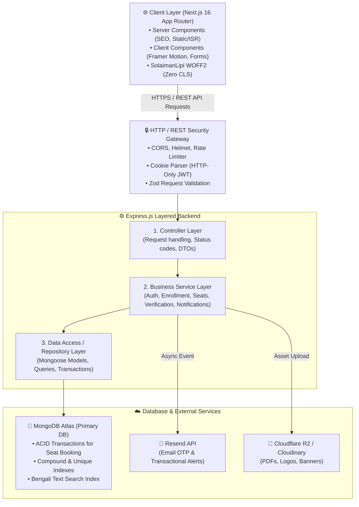
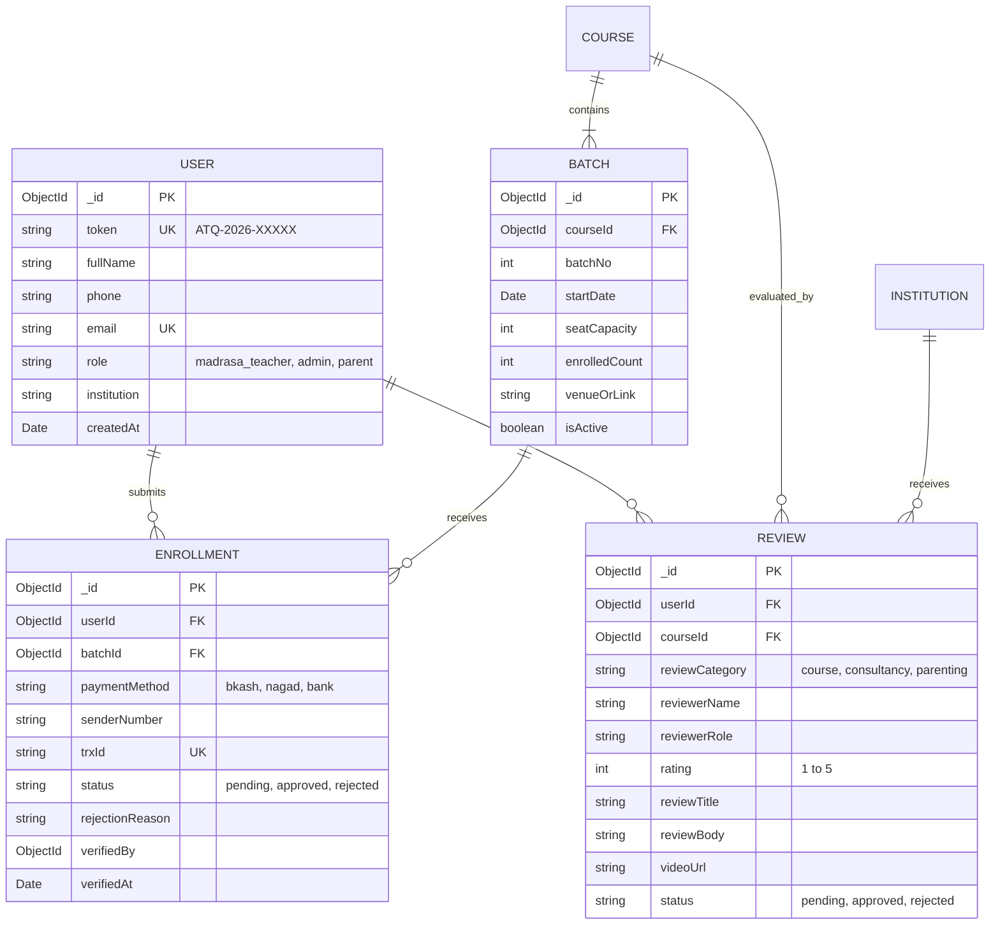
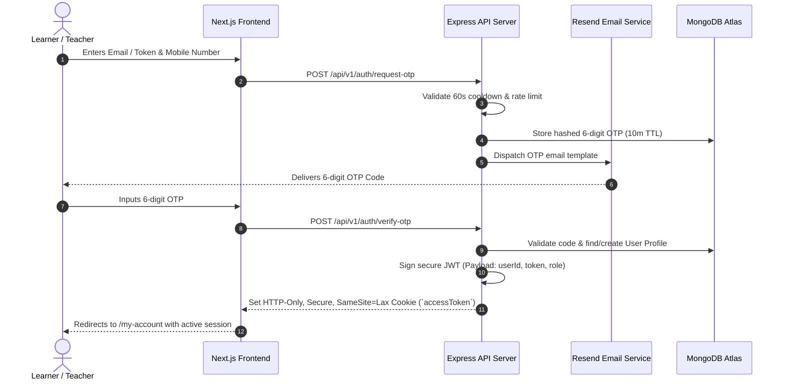

# System Architecture Document
## At-Taqwa Institute Digital Platform

**Version:** 1.0 (Draft Architecture)  
**Architecture Pattern:** Layered Monolith Architecture (Separated Client-Server)  
**Frontend:** Next.js 16 (App Router), React 19, TypeScript, Tailwind CSS v4, Framer Motion  
**Backend:** Express.js, TypeScript, Node.js (Layered Service-Repository Pattern)  
**Database:** MongoDB Atlas (Mongoose ODM, Replica Set with ACID Transactions)  

---

## 1. Architectural Overview & System Topology

The platform follows a **Layered Monolith Architecture** split into a decoupled **Next.js Client Application** and a modular **Express.js RESTful API Backend**, backed by **MongoDB Atlas**:

---

## 2. Express.js Backend: Layered Monolith Design

Folder structure and layer responsibilities (Controllers → Services → Repositories → Models) are documented in [`backend.md` §1](./backend.md#1-layered-monolith-design).

---

## 3. MongoDB Atlas Data Schema & Document Models

### Critical MongoDB Indexes:
- `users`: `{ email: 1 }` (Unique), `{ token: 1 }` (Unique)
- `enrollments`: `{ trxId: 1 }` (Unique, partial filter: `{ status: { $in: ['pending', 'approved'] } }`)
- `batches`: `{ courseId: 1, batchNo: 1 }`
- `courses`: `{ slug: 1 }` (Unique), Text index: `{ title_bn: "text", description_bn: "text" }`
- `otps`: `{ email: 1 }`, TTL index: `{ createdAt: 1 }` with `expireAfterSeconds: 600` (auto-delete expired OTPs after 10 mins).

---

## 4. Key Architectural Subsystems & Flow

### 4.1 Passwordless Auth & Session Lifecycle

---

### 4.2 Race-Condition Proof Seat Booking (MongoDB ACID Transaction)

See [`backend.md` §4](./backend.md#4-race-condition-proof-seat-booking-mongodb-acid-transaction).

---

## 5. Next.js Frontend Integration & Rendering Strategy

| Route / Page | Rendering Strategy | Data Fetching Pattern | Reason |
|---|---|---|---|
| **Homepage (`/`)** | Static / ISR (`revalidate: 120`) | Pre-rendered HTML from Express API | Maximum SEO, fast LCP ($\le 2.0s$), caching at Vercel Edge |
| **Course Catalog (`/courses`)** | ISR (`revalidate: 60`) | Pre-rendered with client-side filter tabs | Instant loading with up-to-date batch status |
| **Course Detail (`/courses/[slug]`)**| Dynamic SSR / ISR | Fetch batch seat count & syllabus | Real-time seat availability check |
| **Reviews Page (`/reviews`)** | ISR (`revalidate: 300`) | Cached approved reviews | Low database read load |
| **Learner Dashboard (`/my-account`)**| Client-Side Rendering (CSR) | Protected REST API with HTTP-only cookie | Personalized private user data |
| **Admin Dashboard (`/admin`)** | CSR with TanStack Query | REST API with RoleGuard middleware | Real-time queue review, mutations, optimistic updates |

---

## 6. Security & Infrastructure Hardening

See [`backend.md` §5](./backend.md#5-security--infrastructure-hardening).

---

*Status: Draft Architecture for Review & Finalization*

