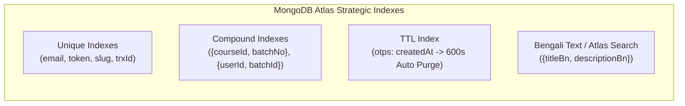
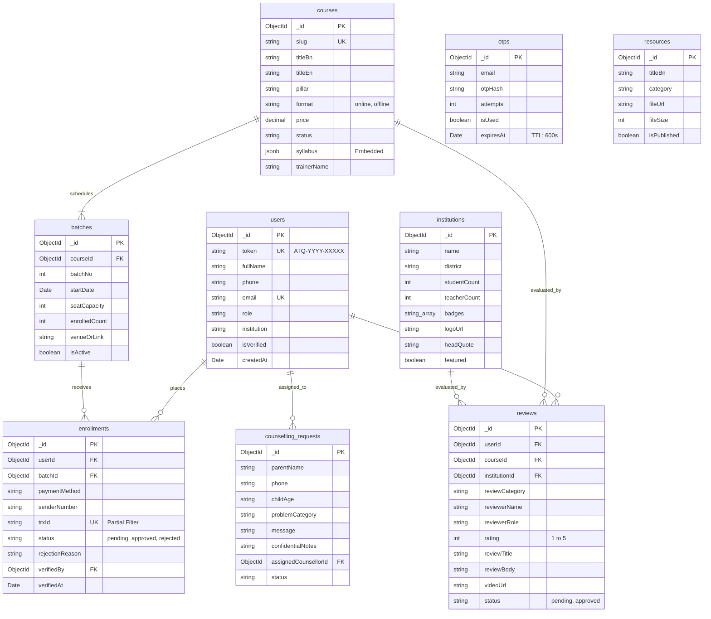

# Database Architecture & Design Specification
## At-Taqwa Institute Digital Platform

**Database Engine:** MongoDB Atlas (v7.0+ Replica Set)  
**Object Data Modeling (ODM):** Mongoose (TypeScript)  
**Architecture:** Layered Monolith Data Access Layer (DAL)  
**Document Scope:** Complete Database Design covering Collections, Schemas, Relationships, Indexes, Validations, Aggregations, ACID Transactions, Mock Data, Mongoose Code & ERD.

---

## 1. Collection List

The database comprises **9 dedicated collections** optimized for performance, scalability, and strict business rule enforcement:

| # | Collection Name | Purpose & Business Domain | Associated PRD / DFD Module |
|---|---|---|---|
| **1** | `users` | User profiles, roles, and unique student tokens (`ATQ-YYYY-XXXXX`). | `Process 1.0` (Auth & Users) |
| **2** | `otps` | Ephemeral 6-digit verification codes with 10-minute TTL auto-purge. | `Process 1.0` (Passwordless OTP) |
| **3** | `courses` | Catalog of online, offline, and hybrid courses and syllabi. | `Process 2.0` (Course Catalog) |
| **4** | `batches` | Batches, start dates, schedules, and dynamic seat capacity counters. | `Process 2.0` & `3.0` (Batch & Seats) |
| **5** | `enrollments` | Applications, MFS payment receipts (bKash/Nagad TrxID), and statuses. | `Process 3.0` (Enrollment Engine) |
| **6** | `institutions` | Partner madrasas and schools showcase directory with verified badges. | `Process 4.0` (Institutional Network) |
| **7** | `counselling_requests`| Confidential family and child psychology counselling intake data. | `Process 5.0` (Confidential Counselling) |
| **8** | `reviews` | Verified student and muhtamim reviews, ratings, and video embeds. | `Process 6.0` (Review Engine) |
| **9** | `resources` | Knowledge Hub articles, downloadable PDF templates, SOPs, and research. | `Process 7.0` (Knowledge Hub CDN) |

---

## 2. Document Schemas & Field Definitions

### 2.1 `users` Collection
Stores registered user identity, contact points, and permanent public identification token.
```json
{
  "_id": "ObjectId('6720f1a1b1c2d3e4f5a6b7c8')",
  "token": "ATQ-2026-87K2M",
  "fullName": "মাওলানা আহমাদুল্লাহ",
  "phone": "01712345678",
  "email": "ahmadullah@example.com",
  "role": "madrasa_teacher",
  "institution": "মারকাযুত তাকওয়া ঢাকা",
  "isVerified": true,
  "privacyConsent": true,
  "createdAt": "2026-10-30T01:00:00.000Z",
  "updatedAt": "2026-10-30T01:00:00.000Z"
}
```

### 2.2 `otps` Collection
Stores transient verification codes. Managed with MongoDB TTL Index for zero manual cleanup.
```json
{
  "_id": "ObjectId('6720f2b2c3d4e5f6a7b8c9d0')",
  "email": "ahmadullah@example.com",
  "otpHash": "9f2c1e7a…(HMAC-SHA256 hex, keyed with OTP_SECRET)",
  "attempts": 0,
  "isUsed": false,
  "expiresAt": "2026-10-30T01:10:00.000Z",
  "createdAt": "2026-10-30T01:00:00.000Z"
}
```

### 2.3 `courses` Collection
Core educational catalog for online and offline offerings.
```json
{
  "_id": "ObjectId('6720f3c3d4e5f6a7b8c9d0e1')",
  "slug": "teaching-proficiency-madrasa",
  "titleBn": "টিচিং প্রফিসিয়েন্সি প্রোগ্রাম (মাদরাসা শিক্ষক)",
  "titleEn": "Teaching Proficiency Program (Madrasa Teachers)",
  "pillar": "training",
  "format": "offline",
  "price": 3000,
  "status": "open",
  "descriptionBn": "মাদরাসা শিক্ষকদের জন্য আধুনিক শিক্ষণ পদ্ধতি ও ক্লাসরুম ম্যানেজমেন্ট প্রশিক্ষণ।",
  "syllabus": [
    {
      "moduleNo": 1,
      "titleBn": "আধুনিক শিখন ও মূল্যায়ন পদ্ধতি",
      "topics": ["পেডাগোজি বনাম আন্দ্রেগোজি", "শিক্ষার্থীর মনস্তত্ত্ব বোঝা"]
    }
  ],
  "trainerName": "মাওলানা মুফতি রফিকুল ইসলাম",
  "trainerPhoto": "https://cdn.attaqwainstitute.com/trainers/rafiqul.webp",
  "createdAt": "2026-10-30T01:00:00.000Z"
}
```

### 2.4 `batches` Collection
Represents scheduled cohorts with seat limits and protected access links.
```json
{
  "_id": "ObjectId('6720f4d4e5f6a7b8c9d0e1f2')",
  "courseId": "ObjectId('6720f3c3d4e5f6a7b8c9d0e1')",
  "batchNo": 14,
  "startDate": "2026-11-15T00:00:00.000Z",
  "scheduleDetails": "প্রতি শুক্রবার ও শনিবার (বিকাল ৩:০০ - ৫:০০)",
  "seatCapacity": 30,
  "enrolledCount": 18,
  "venueOrLink": "সাভার ক্যাম্পাস: ব্যাংক কলোনি, সাভার, ঢাকা (রুম ৩০২)",
  "isActive": true,
  "createdAt": "2026-10-30T01:00:00.000Z"
}
```

### 2.5 `enrollments` Collection
Tracks student registration, bKash/Nagad TrxID audits, and approval state.
```json
{
  "_id": "ObjectId('6720f5e5f6a7b8c9d0e1f2a3')",
  "userId": "ObjectId('6720f1a1b1c2d3e4f5a6b7c8')",
  "batchId": "ObjectId('6720f4d4e5f6a7b8c9d0e1f2')",
  "paymentMethod": "bkash",
  "senderNumber": "01712345678",
  "trxId": "BL9A7K2M10",
  "status": "approved",
  "rejectionReason": null,
  "verifiedBy": "ObjectId('6720f999f6a7b8c9d0e1f299')",
  "verifiedAt": "2026-10-30T02:00:00.000Z",
  "experience": "৫ বছর যাবত হিফজ শিক্ষক হিসেবে কর্মরত",
  "createdAt": "2026-10-30T01:30:00.000Z"
}
```

### 2.6 `institutions` Collection
Showcase of educational institutions receiving At-Taqwa management and monitoring services.
```json
{
  "_id": "ObjectId('6720f6f6a7b8c9d0e1f2a3b4')",
  "name": "মাদরাসাতুত তাকওয়া সাভার",
  "slug": "madrasatut-taqwa-savar",
  "district": "ঢাকা",
  "studentCount": 450,
  "teacherCount": 24,
  "badges": ["management_partner", "monitoring_partner", "trained_faculty"],
  "logoUrl": "https://cdn.attaqwainstitute.com/institutions/taqwa-logo.webp",
  "headName": "মাওলানা হাফিজুর রহমান",
  "headQuote": "আত-তাকওয়ার ৯-ধাপ মনিটরিং চালুর পর আমাদের শিক্ষার্থীদের পড়ার আগ্রহ ও শৃঙ্খলা অভাবনীয় বৃদ্ধি পেয়েছে।",
  "contactPhone": "01612417120",
  "featured": true,
  "createdAt": "2026-10-30T01:00:00.000Z"
}
```

### 2.7 `counselling_requests` Collection
Highly confidential child psychology and parental counselling intake cases.
```json
{
  "_id": "ObjectId('6720f7a7b8c9d0e1f2a3b4c5')",
  "parentName": "সুলতানা পারভীন",
  "phone": "01819876543",
  "childAge": "৮-১২ বছর",
  "problemCategory": "screen_addiction",
  "preferredTime": "বিকাল",
  "message": "সন্তান মোবাইল গেমসে অতিমাত্রায় আসক্ত, পড়াশোনায় একেবারেই মনোযোগ দিচ্ছে না।",
  "confidentialNotes": "প্রথম সেশন সম্পন্ন। স্ক্রিন টাইম দৈনিক ১ ঘণ্টায় নামিয়ে আনার ট্র্যাকার দেওয়া হয়েছে।",
  "assignedCounsellorId": "ObjectId('6720f888b8c9d0e1f2a3b488')",
  "status": "in_progress",
  "createdAt": "2026-10-30T01:15:00.000Z"
}
```

### 2.8 `reviews` Collection
Verified 1-5 star feedback with student token attachment and video URL options.
```json
{
  "_id": "ObjectId('6720f8b8c9d0e1f2a3b4c5d6')",
  "userId": "ObjectId('6720f1a1b1c2d3e4f5a6b7c8')",
  "courseId": "ObjectId('6720f3c3d4e5f6a7b8c9d0e1')",
  "institutionId": null,
  "reviewCategory": "course",
  "reviewerName": "মাওলানা আহমাদুল্লাহ",
  "reviewerRole": "হিফজ শিক্ষক, মারকাযুত তাকওয়া",
  "rating": 5,
  "reviewTitle": "শিক্ষণ পদ্ধতিতে নতুন দিগন্ত খুলে দিয়েছে",
  "reviewBody": "এই প্রশিক্ষণে অংশ নেওয়ার পর আমার ক্লাসরুম পরিচালনার মানসিকতা পুরোপুরি বদলে গেছে। অসাধারণ কোর্স!",
  "videoUrl": "https://www.youtube.com/watch?v=dQw4w9WgXcQ",
  "isVerifiedUser": true,
  "status": "approved",
  "moderatedBy": "ObjectId('6720f999f6a7b8c9d0e1f299')",
  "createdAt": "2026-10-30T02:30:00.000Z"
}
```

### 2.9 `resources` Collection
Downloadable PDFs, SOP templates, guides, and research publications.
```json
{
  "_id": "ObjectId('6720f9c9d0e1f2a3b4c5d6e7')",
  "titleBn": "মাদরাসা শিক্ষক মূল্যায়ন ও মনিটরিং চেকলিস্ট (SOP)",
  "titleEn": "Madrasa Teacher Evaluation and Monitoring Checklist SOP",
  "category": "sop_template",
  "tags": ["monitoring", "sop", "evaluation"],
  "fileUrl": "https://cdn.attaqwainstitute.com/sops/teacher-monitoring-sop.pdf",
  "fileSize": 2450000,
  "thumbnailUrl": "https://cdn.attaqwainstitute.com/sops/thumb-monitoring.webp",
  "author": "আত-তাকওয়া রিসার্চ সেল",
  "isPublished": true,
  "downloadsCount": 432,
  "createdAt": "2026-10-30T01:00:00.000Z"
}
```

---

## 3. Relationships & Data Modeling Strategy

In MongoDB, choosing between **Referencing (Normalized)** and **Embedding (Denormalized)** is critical for write performance and query speed:

```mermaid
flowchart TD
    User["users (Profile)"]
    Course["courses"]
    Batch["batches"]
    Enrollment["enrollments"]
    Review["reviews"]
    Institution["institutions"]

    Course -->|1 : N (Embedded Syllabus)| Course
    Course -->|1 : N (Referenced)| Batch
    User -->|1 : N (Referenced)| Enrollment
    Batch -->|1 : N (Referenced)| Enrollment
    User -->|1 : N (Referenced)| Review
    Course -->|1 : N (Referenced)| Review
    Institution -->|1 : N (Referenced)| Review
```

### Modeling Design Rationale:
1. **Embedded Syllabus in `courses`:** A course syllabus is bounded, small (<50KB), and always queried together with the course details. Embedding prevents multi-collection `$lookup` joins.
2. **Referenced Batches in `batches`:** Batches have dynamic seat changes and high write concurrency. Keeping them in a separate collection prevents unbounded document growth on `courses`.
3. **Normalized `enrollments`:** Enrollments reference `userId` and `batchId`. This guarantees clean indexing, independent status mutation, and prevents large array updates on user records.
4. **Isomorphic `reviews`:** Reviews reference `userId` (for verification) and optionally `courseId` or `institutionId`, allowing the same collection to power course ratings and institutional client feedback.

---

## 4. Database Indexing Strategy



| Collection | Index Fields | Index Type | Business / Performance Rationale |
|---|---|---|---|
| `users` | `{ email: 1 }` | Unique | Enforces single account per email address. |
| `users` | `{ token: 1 }` | Unique | Guarantees absolute uniqueness for Student IDs (`ATQ-XXXX`). |
| `users` | `{ phone: 1 }` | Standard (B-Tree) | Fast lookup during admin support calls. |
| `otps` | `{ email: 1 }` | Standard | Quick retrieval during OTP validation. |
| `otps` | `{ createdAt: 1 }` | **TTL Index (`expireAfterSeconds: 600`)** | Auto-purges expired codes after 10 minutes. Zero DB bloat. |
| `courses`| `{ slug: 1 }` | Unique | URL routing lookup (`/courses/[slug]`) in $\mathcal{O}(1)$. |
| `courses`| `{ titleBn: "text", descriptionBn: "text" }` | Text Index (Bengali) | Fast keyword search on Knowledge Hub & Catalog. |
| `batches`| `{ courseId: 1, batchNo: 1 }` | Compound Unique | Prevents duplicate batch numbers within the same course. |
| `enrollments` | `{ trxId: 1 }` | **Partial Unique (`{ status: { $in: ['pending', 'approved'] } }`)** | Prevents TrxID reuse while allowing users to re-submit rejected ones. |
| `enrollments` | `{ userId: 1, batchId: 1 }` | Compound | Fast check for duplicate enrollment in the same batch. |
| `institutions`| `{ district: 1, featured: -1 }` | Compound | Powers location-based partner filtering and homepage showcase. |
| `reviews`| `{ courseId: 1, status: 1 }` | Compound | Rapidly loads approved reviews on course detail pages. |

---

## 5. Validation Rules (Schema Constraints)

Validation is enforced using **Mongoose Schema Validators** alongside **MongoDB JSON Schema Constraints** to guarantee clean data:

```typescript
// Example: Strict Phone, TrxID & Rating Validators
export const bdPhoneValidator = {
  validator: (v: string) => /^01[3-9]\d{8}$/.test(v),
  message: "সঠিক ১১ ডিজিটের বাংলাদেশি মোবাইল নম্বর দিন (যেমন: 01712345678)"
};

export const trxIdValidator = {
  validator: (v: string) => /^[A-Za-z0-9]{8,15}$/.test(v),
  message: "সঠিক ৮-১৫ অক্ষরের বিকাশ/নগদ ট্রানজেকশন আইডি (TrxID) দিন"
};

export const tokenValidator = {
  validator: (v: string) => /^ATQ-\d{4}-[A-Z0-9]{5}$/.test(v),
  message: "টোকেন অবশ্যই ATQ-YYYY-XXXXX ফরম্যাটে হতে হবে"
};
```

---

## 6. Production Aggregation Pipelines

### 6.1 Pipeline 1: Course Detail with Live Seat & Review Metrics
Computes average star rating, total review count, and active batches with remaining seats in a single query:

```javascript
db.courses.aggregate([
  { $match: { slug: "teaching-proficiency-madrasa" } },
  // 1. Join Batches
  {
    $lookup: {
      from: "batches",
      localField: "_id",
      foreignField: "courseId",
      pipeline: [
        { $match: { isActive: true } },
        {
          $project: {
            batchNo: 1,
            startDate: 1,
            seatCapacity: 1,
            enrolledCount: 1,
            remainingSeats: { $subtract: ["$seatCapacity", "$enrolledCount"] },
            isHouseful: { $gte: ["$enrolledCount", "$seatCapacity"] }
          }
        }
      ],
      as: "activeBatches"
    }
  },
  // 2. Join Reviews Summary
  {
    $lookup: {
      from: "reviews",
      localField: "_id",
      foreignField: "courseId",
      pipeline: [
        { $match: { status: "approved" } },
        {
          $group: {
            _id: null,
            averageRating: { $avg: "$rating" },
            totalReviews: { $sum: 1 }
          }
        }
      ],
      as: "reviewStats"
    }
  },
  {
    $project: {
      titleBn: 1,
      price: 1,
      format: 1,
      activeBatches: 1,
      averageRating: { $ifNull: [{ $arrayElemAt: ["$reviewStats.averageRating", 0] }, 5.0] },
      totalReviews: { $ifNull: [{ $arrayElemAt: ["$reviewStats.totalReviews", 0] }, 0] }
    }
  }
]);
```

### 6.2 Pipeline 2: Admin Financial Audit & Pending TrxID Queue
Groups incoming revenue by payment method (bKash vs Nagad) and counts pending verifications:

```javascript
db.enrollments.aggregate([
  {
    $group: {
      _id: {
        paymentMethod: "$paymentMethod",
        status: "$status"
      },
      count: { $sum: 1 }
    }
  },
  {
    $project: {
      _id: 0,
      paymentMethod: "$_id.paymentMethod",
      status: "$_id.status",
      totalTransactions: "$count"
    }
  }
]);
```

---

## 7. Multi-Document ACID Transactions (Seat Booking Concurrency)

The seat-booking transaction is implemented in the service layer through repositories, not as a standalone function. Code, concurrency scenarios and retry behaviour: [`backend.md` §4](./backend.md#4-race-condition-proof-seat-booking-mongodb-acid-transaction).

Database requirements it relies on:

- MongoDB must run as a **replica set** (Atlas clusters always do). Transactions are not available on a standalone `mongod`.
- `batches`: the atomic filter `{ _id, $expr: { $lt: ["$enrolledCount", "$seatCapacity"] } }` with `$inc: { enrolledCount: 1 }`. `enrolledCount` has `min: 0`.
- `enrollments`: the conditional update `{ _id, status: "pending" }`, and the partial unique index on `trxId` (§4).

---

## 8. Sample Mock Data (JSON)

### 8.1 User Profile Sample
```json
{
  "_id": { "$oid": "6720f1a1b1c2d3e4f5a6b7c8" },
  "token": "ATQ-2026-92P4L",
  "fullName": "মাওলানা জাহিদুল হাসান",
  "phone": "01912345678",
  "email": "zahid.hasan@example.com",
  "role": "madrasa_teacher",
  "institution": "দারুল উলুম সাভার",
  "isVerified": true,
  "privacyConsent": true,
  "createdAt": { "$date": "2026-10-30T01:00:00Z" }
}
```

### 8.2 Batch Sample
```json
{
  "_id": { "$oid": "6720f4d4e5f6a7b8c9d0e1f2" },
  "courseId": { "$oid": "6720f3c3d4e5f6a7b8c9d0e1" },
  "batchNo": 1,
  "startDate": { "$date": "2026-11-20T00:00:00Z" },
  "scheduleDetails": "শুক্রবার ও শনিবার বিকাল ৩:০০ - ৫:০০",
  "seatCapacity": 30,
  "enrolledCount": 29,
  "venueOrLink": "https://zoom.us/j/9876543210?pwd=secretPassword",
  "isActive": true
}
```

### 8.3 Enrollment Sample
```json
{
  "_id": { "$oid": "6720f5e5f6a7b8c9d0e1f2a3" },
  "userId": { "$oid": "6720f1a1b1c2d3e4f5a6b7c8" },
  "batchId": { "$oid": "6720f4d4e5f6a7b8c9d0e1f2" },
  "paymentMethod": "bkash",
  "senderNumber": "01912345678",
  "trxId": "BK87X992A1",
  "status": "pending",
  "experience": "৭ বছর হিফজ শিক্ষক",
  "createdAt": { "$date": "2026-10-30T02:00:00Z" }
}
```

### 8.4 Otp Sample
```json
{
  "_id": { "$oid": "6720f2b2c3d4e5f6a7b8c9d0" },
  "email": "zahid.hasan@example.com",
  "otpHash": "9f2c1e7a4b0d6e3f8a1c5b2d9e7f0a3c6b8d1e4f7a0c3b6d9e2f5a8b1c4d7e0f",
  "attempts": 0,
  "isUsed": false,
  "expiresAt": { "$date": "2026-10-30T01:10:00Z" },
  "createdAt": { "$date": "2026-10-30T01:00:00Z" }
}
```

### 8.5 Course Sample
```json
{
  "_id": { "$oid": "6720f3c3d4e5f6a7b8c9d0e1" },
  "slug": "teaching-proficiency-madrasa",
  "titleBn": "টিচিং প্রফিসিয়েন্সি প্রোগ্রাম (মাদরাসা শিক্ষক)",
  "titleEn": "Teaching Proficiency Program (Madrasa Teachers)",
  "pillar": "training",
  "format": "offline",
  "price": 3000,
  "status": "open",
  "descriptionBn": "মাদরাসা শিক্ষকদের জন্য আধুনিক শিক্ষণ পদ্ধতি ও ক্লাসরুম ম্যানেজমেন্ট প্রশিক্ষণ।",
  "syllabus": [
    {
      "moduleNo": 1,
      "titleBn": "আধুনিক শিখন ও মূল্যায়ন পদ্ধতি",
      "topics": ["পেডাগোজি বনাম আন্দ্রেগোজি", "শিক্ষার্থীর মনস্তত্ত্ব বোঝা"]
    }
  ],
  "trainerName": "মাওলানা মুফতি রফিকুল ইসলাম",
  "trainerPhoto": "https://cdn.attaqwainstitute.com/trainers/rafiqul.webp"
}
```

### 8.6 Institution Sample
```json
{
  "_id": { "$oid": "6720f6f6a7b8c9d0e1f2a3b4" },
  "name": "মাদরাসাতুত তাকওয়া সাভার",
  "slug": "madrasatut-taqwa-savar",
  "district": "ঢাকা",
  "studentCount": 450,
  "teacherCount": 24,
  "badges": ["management_partner", "monitoring_partner", "trained_faculty"],
  "logoUrl": "https://cdn.attaqwainstitute.com/institutions/taqwa-logo.webp",
  "headQuote": "৯-ধাপ মনিটরিং চালুর পর শিক্ষার্থীদের পড়া ও শৃঙ্খলায় অভাবনীয় পরিবর্তন এসেছে।",
  "featured": true,
  "status": "active"
}
```

### 8.7 Counselling Request Sample
```json
{
  "_id": { "$oid": "6720f7a7b8c9d0e1f2a3b4c5" },
  "parentName": "সুলতানা পারভীন",
  "phone": "01819876543",
  "childAge": "৮-১২ বছর",
  "problemCategory": "screen_addiction",
  "preferredTime": "বিকাল",
  "message": "সন্তান মোবাইল গেমসে অতিমাত্রায় আসক্ত, পড়াশোনায় একেবারেই মনোযোগ দিচ্ছে না।",
  "confidentialNotes": "প্রথম সেশন সম্পন্ন। স্ক্রিন টাইম দৈনিক ১ ঘণ্টায় নামানোর পরামর্শ।",
  "status": "in_progress"
}
```

### 8.8 Review Sample
```json
{
  "_id": { "$oid": "6720f8b8c9d0e1f2a3b4c5d6" },
  "userId": { "$oid": "6720f1a1b1c2d3e4f5a6b7c8" },
  "courseId": { "$oid": "6720f3c3d4e5f6a7b8c9d0e1" },
  "reviewCategory": "course",
  "reviewerName": "মাওলানা আহমাদুল্লাহ",
  "reviewerRole": "হিফজ শিক্ষক",
  "rating": 5,
  "reviewTitle": "শিক্ষণ পদ্ধতিতে নতুন দিগন্ত খুলে দিয়েছে",
  "reviewBody": "এই প্রশিক্ষণে অংশ নেওয়ার পর আমার ক্লাসরুম পরিচালনার মানসিকতা পুরোপুরি বদলে গেছে।",
  "videoUrl": "https://www.youtube.com/watch?v=dQw4w9WgXcQ",
  "isVerifiedUser": true,
  "status": "approved"
}
```

### 8.9 Resource Sample
```json
{
  "_id": { "$oid": "6720f9c9d0e1f2a3b4c5d6e7" },
  "titleBn": "মাদরাসা শিক্ষক মূল্যায়ন ও মনিটরিং চেকলিস্ট (SOP)",
  "category": "sop_template",
  "tags": ["monitoring", "sop", "evaluation"],
  "fileUrl": "https://cdn.attaqwainstitute.com/sops/teacher-monitoring-sop.pdf",
  "fileSize": 2450000,
  "isPublished": true,
  "downloadsCount": 432
}
```

---

## 9. Production Mongoose Schemas (TypeScript)

### 9.1 `User.model.ts`
```typescript
import { Schema, model, Document } from "mongoose";

export interface IUser extends Document {
  token: string;
  fullName: string;
  phone: string;
  email: string;
  role: "madrasa_teacher" | "general_teacher" | "madrasa_admin" | "parent" | "student" | "researcher" | "counsellor" | "content_editor" | "super_admin" | "other";
  institution?: string;
  isVerified: boolean;
  privacyConsent: boolean;
  createdAt: Date;
  updatedAt: Date;
}

const userSchema = new Schema<IUser>(
  {
    token: {
      type: String,
      required: true,
      unique: true,
      match: [/^ATQ-\d{4}-[A-Z0-9]{5}$/, "Invalid student token format"],
      index: true,
    },
    fullName: { type: String, required: true, trim: true, minlength: 3, maxlength: 80 },
    phone: {
      type: String,
      required: true,
      match: [/^01[3-9]\d{8}$/, "Invalid Bangladeshi phone number"],
      index: true,
    },
    email: {
      type: String,
      required: true,
      unique: true,
      lowercase: true,
      trim: true,
      index: true,
    },
    role: {
      type: String,
      enum: ["madrasa_teacher", "general_teacher", "madrasa_admin", "parent", "student", "researcher", "counsellor", "content_editor", "super_admin", "other"],
      required: true,
      default: "student",
      index: true,
    },
    institution: { type: String, maxlength: 150 },
    isVerified: { type: Boolean, default: false },
    privacyConsent: { type: Boolean, required: true },
  },
  { timestamps: true }
);

export const User = model<IUser>("User", userSchema);
```

### 9.2 `Enrollment.model.ts`
```typescript
import { Schema, model, Document, Types } from "mongoose";

export interface IEnrollment extends Document {
  userId: Types.ObjectId;
  batchId: Types.ObjectId;
  paymentMethod: "bkash" | "nagad" | "bank";
  senderNumber: string;
  trxId: string;
  status: "pending" | "approved" | "rejected";
  rejectionReason?: string;
  verifiedBy?: Types.ObjectId;
  verifiedAt?: Date;
  experience?: string;
  createdAt: Date;
}

const enrollmentSchema = new Schema<IEnrollment>(
  {
    userId: { type: Schema.Types.ObjectId, ref: "User", required: true, index: true },
    batchId: { type: Schema.Types.ObjectId, ref: "Batch", required: true, index: true },
    paymentMethod: { type: String, enum: ["bkash", "nagad", "bank"], required: true },
    senderNumber: {
      type: String,
      required: true,
      match: [/^01[3-9]\d{8}$/, "Invalid phone number"],
    },
    trxId: {
      type: String,
      required: true,
      uppercase: true,
      trim: true,
      match: [/^[A-Za-z0-9]{8,15}$/, "Invalid TrxID format"],
    },
    status: {
      type: String,
      enum: ["pending", "approved", "rejected"],
      default: "pending",
      index: true,
    },
    rejectionReason: { type: String, maxlength: 500 },
    verifiedBy: { type: Schema.Types.ObjectId, ref: "User" },
    verifiedAt: { type: Date },
    experience: { type: String, maxlength: 300 },
  },
  { timestamps: true }
);

// Unique partial index on TrxID for non-rejected enrollments
enrollmentSchema.index(
  { trxId: 1 },
  { unique: true, partialFilterExpression: { status: { $in: ["pending", "approved"] } } }
);

export const Enrollment = model<IEnrollment>("Enrollment", enrollmentSchema);

### 9.3 `Otp.model.ts`
```typescript
import { Schema, model, Document } from "mongoose";

export interface IOtp extends Document {
  email: string;
  otpHash: string;
  attempts: number;
  isUsed: boolean;
  expiresAt: Date;
  createdAt: Date;
}

const otpSchema = new Schema<IOtp>(
  {
    email: { type: String, required: true, lowercase: true, trim: true, index: true },
    otpHash: { type: String, required: true },
    attempts: { type: Number, default: 0, max: 3 },
    isUsed: { type: Boolean, default: false },
    expiresAt: { type: Date, required: true },
  },
  { timestamps: true }
);

// TTL index to automatically purge records after 10 minutes (600 seconds)
otpSchema.index({ createdAt: 1 }, { expireAfterSeconds: 600 });

export const Otp = model<IOtp>("Otp", otpSchema);
```

### 9.4 `Course.model.ts`
```typescript
import { Schema, model, Document } from "mongoose";

export interface ISyllabusModule {
  moduleNo: number;
  titleBn: string;
  topics: string[];
}

export interface ICourse extends Document {
  slug: string;
  titleBn: string;
  titleEn?: string;
  pillar: "training" | "consultancy" | "digital";
  format: "online" | "offline" | "hybrid";
  price: number;
  status: "open" | "upcoming" | "closed";
  descriptionBn: string;
  descriptionEn?: string;
  syllabus: ISyllabusModule[];
  trainerName?: string;
  trainerBio?: string;
  trainerPhoto?: string;
}

const syllabusModuleSchema = new Schema<ISyllabusModule>(
  {
    moduleNo: { type: Number, required: true },
    titleBn: { type: String, required: true },
    topics: [{ type: String }],
  },
  { _id: false }
);

const courseSchema = new Schema<ICourse>(
  {
    slug: { type: String, required: true, unique: true, index: true },
    titleBn: { type: String, required: true },
    titleEn: { type: String },
    pillar: { type: String, enum: ["training", "consultancy", "digital"], required: true },
    format: { type: String, enum: ["online", "offline", "hybrid"], required: true },
    price: { type: Number, required: true, min: 0 },
    status: { type: String, enum: ["open", "upcoming", "closed"], default: "open" },
    descriptionBn: { type: String, required: true },
    descriptionEn: { type: String },
    syllabus: [syllabusModuleSchema],
    trainerName: { type: String },
    trainerBio: { type: String },
    trainerPhoto: { type: String },
  },
  { timestamps: true }
);

courseSchema.index({ titleBn: "text", descriptionBn: "text" });

export const Course = model<ICourse>("Course", courseSchema);
```

### 9.5 `Batch.model.ts`
```typescript
import { Schema, model, Document, Types } from "mongoose";

export interface IBatch extends Document {
  courseId: Types.ObjectId;
  batchNo: number;
  startDate: Date;
  scheduleDetails: string;
  seatCapacity: number;
  enrolledCount: number;
  venueOrLink: string;
  isActive: boolean;
}

const batchSchema = new Schema<IBatch>(
  {
    courseId: { type: Schema.Types.ObjectId, ref: "Course", required: true, index: true },
    batchNo: { type: Number, required: true },
    startDate: { type: Date, required: true },
    scheduleDetails: { type: String, required: true },
    seatCapacity: { type: Number, required: true, default: 30, min: 1 },
    enrolledCount: { type: Number, default: 0, min: 0 },
    venueOrLink: { type: String, required: true },
    isActive: { type: Boolean, default: true, index: true },
  },
  { timestamps: true }
);

batchSchema.index({ courseId: 1, batchNo: 1 }, { unique: true });

export const Batch = model<IBatch>("Batch", batchSchema);
```

### 9.6 `Institution.model.ts`
```typescript
import { Schema, model, Document } from "mongoose";

export interface IInstitution extends Document {
  name: string;
  slug: string;
  district: string;
  studentCount?: number;
  teacherCount?: number;
  badges: ("management_partner" | "monitoring_partner" | "trained_faculty")[];
  logoUrl?: string;
  headName?: string;
  headQuote?: string;
  contactPhone?: string;
  featured: boolean;
  status: "pending" | "active" | "archived";
}

const institutionSchema = new Schema<IInstitution>(
  {
    name: { type: String, required: true, trim: true },
    slug: { type: String, required: true, unique: true, index: true },
    district: { type: String, required: true, index: true },
    studentCount: { type: Number, min: 0 },
    teacherCount: { type: Number, min: 0 },
    badges: [{ type: String, enum: ["management_partner", "monitoring_partner", "trained_faculty"] }],
    logoUrl: { type: String },
    headName: { type: String },
    headQuote: { type: String, maxlength: 500 },
    contactPhone: { type: String },
    featured: { type: Boolean, default: false, index: true },
    status: {
      type: String,
      enum: ["pending", "active", "archived"],
      default: "pending",
      index: true,
    },
  },
  { timestamps: true }
);

export const Institution = model<IInstitution>("Institution", institutionSchema);
```

### 9.7 `Counselling.model.ts`
```typescript
import { Schema, model, Document, Types } from "mongoose";

export interface ICounselling extends Document {
  parentName: string;
  phone: string;
  childAge: string;
  problemCategory: "behavioral" | "screen_addiction" | "inattention" | "adolescence" | "other";
  preferredTime: string;
  message: string;
  confidentialNotes?: string;
  assignedCounsellorId?: Types.ObjectId;
  status: "new" | "in_progress" | "resolved";
}

const counsellingSchema = new Schema<ICounselling>(
  {
    parentName: { type: String, required: true, trim: true },
    phone: { type: String, required: true, match: [/^01[3-9]\d{8}$/, "Invalid phone"] },
    childAge: { type: String, required: true },
    problemCategory: {
      type: String,
      enum: ["behavioral", "screen_addiction", "inattention", "adolescence", "other"],
      required: true,
    },
    preferredTime: { type: String, required: true },
    message: { type: String, required: true, minlength: 20 },
    confidentialNotes: { type: String },
    assignedCounsellorId: { type: Schema.Types.ObjectId, ref: "User", index: true },
    status: { type: String, enum: ["new", "in_progress", "resolved"], default: "new", index: true },
  },
  { timestamps: true }
);

export const Counselling = model<ICounselling>("Counselling", counsellingSchema, "counselling_requests");
```

### 9.8 `Review.model.ts`
```typescript
import { Schema, model, Document, Types } from "mongoose";

export interface IReview extends Document {
  userId: Types.ObjectId;
  courseId?: Types.ObjectId;
  institutionId?: Types.ObjectId;
  reviewCategory: "course" | "consultancy" | "parenting";
  reviewerName: string;
  reviewerRole: string;
  rating: number;
  reviewTitle: string;
  reviewBody: string;
  videoUrl?: string;
  isVerifiedUser: boolean;
  status: "pending" | "approved" | "rejected";
  moderatedBy?: Types.ObjectId;
}

const reviewSchema = new Schema<IReview>(
  {
    userId: { type: Schema.Types.ObjectId, ref: "User", required: true, index: true },
    courseId: { type: Schema.Types.ObjectId, ref: "Course", index: true },
    institutionId: { type: Schema.Types.ObjectId, ref: "Institution", index: true },
    reviewCategory: { type: String, enum: ["course", "consultancy", "parenting"], required: true },
    reviewerName: { type: String, required: true },
    reviewerRole: { type: String, required: true },
    rating: { type: Number, required: true, min: 1, max: 5 },
    reviewTitle: { type: String, required: true, maxlength: 120 },
    reviewBody: { type: String, required: true, maxlength: 1000 },
    videoUrl: { type: String },
    isVerifiedUser: { type: Boolean, default: true },
    status: { type: String, enum: ["pending", "approved", "rejected"], default: "pending", index: true },
    moderatedBy: { type: Schema.Types.ObjectId, ref: "User" },
  },
  { timestamps: true }
);

reviewSchema.index({ courseId: 1, status: 1 });

export const Review = model<IReview>("Review", reviewSchema);
```

### 9.9 `Resource.model.ts`
```typescript
import { Schema, model, Document } from "mongoose";

export interface IResource extends Document {
  titleBn: string;
  titleEn?: string;
  category: "article" | "guide" | "sop_template" | "research";
  tags: string[];
  fileUrl?: string;
  fileSize?: number;
  thumbnailUrl?: string;
  author: string;
  isPublished: boolean;
  downloadsCount: number;
}

const resourceSchema = new Schema<IResource>(
  {
    titleBn: { type: String, required: true },
    titleEn: { type: String },
    category: {
      type: String,
      enum: ["article", "guide", "sop_template", "research"],
      required: true,
      index: true,
    },
    tags: [{ type: String }],
    fileUrl: { type: String },
    fileSize: { type: Number },
    thumbnailUrl: { type: String },
    author: { type: String, default: "আত-তাকওয়া রিসার্চ সেল" },
    isPublished: { type: Boolean, default: true, index: true },
    downloadsCount: { type: Number, default: 0 },
  },
  { timestamps: true }
);

resourceSchema.index({ titleBn: "text", tags: "text" });

export const Resource = model<IResource>("Resource", resourceSchema);
```
```

---

## 10. Entity Relationship Diagram (ERD)



---

*Specification Approved by: At-Taqwa Institute Lead Database Architect*  
*Document Target: Ready for Sprint 1 MongoDB Atlas Cluster Initialization*
