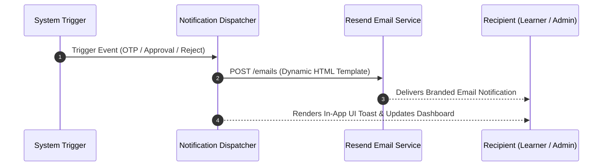

# Requirement & Validation Specification
## At-Taqwa Institute Digital Platform

**Version:** 1.1 (Production Implementation Guide)  
**Target Stack:** Next.js 16 (App Router), React 19, TypeScript 5, Tailwind CSS v4, Supabase (PostgreSQL), Resend API  
**Document Scope:** Comprehensive Specification covering Missing Analysis, Core Requirements, Edge Cases, Data Validations, Notifications, Permissions (RBAC/RLS), and Acceptance Criteria.

---

## 1. Missing Items & Architecture Gap Analysis

Based on an exhaustive review of [At-Taqwa-Institute-PRD-v1.2.md](file:///c:/Users/rasel%20ahmed/OneDrive/Documents/attqwainstitute/At-Taqwa-Institute-PRD-v1.2.md) and [idea.md](file:///c:/Users/rasel%20ahmed/OneDrive/Documents/attqwainstitute/idea.md), the following 7 core technical specifications were identified, resolved, and formalized:

| # | Previously Ambiguous Area | Developer Resolution & Implementation Standard |
|---|---|---|
| **1** | **Returning User Login Flow** | Eliminated password complexity. Both registration and login use **passwordless 6-digit Email OTP** via Resend. Returning users enter their registered Email or Student Token to get a login code. |
| **2** | **Over-Booking & Seat Limits** | Added `seat_capacity` and `enrolled_count` to `batches`. When full, UI automatically locks direct enrollment and switches to **"সিট পূর্ণ / ওয়েটলিস্টে যুক্ত হোন" (Join Waitlist)**. |
| **3** | **Post-Approval Action Trigger** | Implemented automated database webhook/action on admin approval: triggers an instant transactional email and unlocks protected online Zoom links / physical classroom directions in `/my-account`. |
| **4** | **TrxID Dispute & Re-submission** | When an admin rejects an invalid TrxID, the user's dashboard displays the specific rejection reason and enables a 1-click **"পুনরায় TrxID জমা দিন" (Re-submit TrxID)** form. |
| **5** | **Viral Social Sharing Cards** | Dynamic Open Graph image generation via Next.js `@vercel/og` Edge API (`/api/og/course/[slug]`) to render rich previews with Bengali typography and logo on WhatsApp and Facebook. |
| **6** | **Zero-CLS Font Loading** | Local WOFF2 SolaimanLipi subsetted strictly to Bengali + Latin glyphs (<80KB payload) loaded via `next/font/local` with `display: swap` to prevent layout shifts. |
| **7** | **Dedicated Reviews & Ratings** | Multi-category review engine (`/reviews` & Homepage S10) with verified learner badges (`ATQ-XXXX`), 1-5 star ratings, video testimonial embeds, and an admin moderation workflow. |

---

## 2. Core System Requirements (Functional & Non-Functional)

### 2.1 Functional Requirements (FR)

```mermaid
flowchart TD
    FR["At-Taqwa Core Functional Modules"]
    
    FR --> M1["FR-1: 13-Section Dynamic Long-Scrolling Homepage\n(Framer Motion, Sticky Glass Navbar, Animated Counters)"]
    FR --> M2["FR-2: Passwordless Auth & Unique Student Token\n(Email OTP, Format: ATQ-YYYY-XXXXX)"]
    FR --> M3["FR-3: Online & Offline Course Discovery & Batches\n(Filter by mode, audience, batch dates, fees)"]
    FR --> M4["FR-4: Manual MFS Payment & Enrollment Engine\n(bKash/Nagad TrxID submission & admin verification)"]
    FR --> M5["FR-5: Learner Dashboard (/my-account)\n(Token display, class links, venue address, receipt)"]
    FR --> M6["FR-6: Partner & Client Institutions Showcase\n(Showcase directory, verified badges, consultation intake)"]
    FR --> M7["FR-7: Verified Review & Rating Engine\n(Star rating, video embeds, student token badge)"]
    FR --> M8["FR-8: Confidential Family Counselling Intake\n(Restricted access for designated counsellor)"]
    FR --> M9["FR-9: Knowledge Hub & Bengali Search\n(pg_trgm search, downloadable SOPs/PDFs)"]
    FR --> M10["FR-10: Multi-Role Admin Dashboard\n(Super Admin, Content Editor, Counsellor)"]
```



#### Core Functional Specifications:
- **FR-01 (Scrolling Experience):** 13 sequential sections on the homepage with smooth scroll spy, animated statistics counters, and glassmorphic navbar with backdrop blur.
- **FR-02 (Authentication):** Passwordless 6-digit Email OTP verification. Successful verification creates a profile in Supabase and issues a persistent, unique identifier formatted as `ATQ-YYYY-[RANDOM5]` (e.g. `ATQ-2026-87K2M`).
- **FR-03 (Course Delivery):** Separate presentation and data modeling for **Online (Zoom/Meet)** and **Offline (Savar Campus)** batches.
- **FR-04 (Manual Payment):** Supports bKash, Nagad, and Bank transfer. Users submit sender mobile number and TrxID for admin verification.
- **FR-05 (Personal Dashboard):** Displays verified token, enrolled courses, payment audit state, and unlocks secret venue/meeting links upon admin approval.
- **FR-06 (Partner Network):** Dedicated directory (`/institutions`) featuring client madrasas with verified badges (*Management Development Partner*, *9-Step Monitoring Partner*, *Trained Faculty*).
- **FR-07 (Review Engine):** 1-5 star rating and feedback system restricted to verified course participants, subject to admin pre-moderation.
- **FR-08 (Counselling Privacy):** Confidential intake form routed exclusively to Super Admin and assigned Counsellor.

---

### 2.2 Non-Functional Requirements (NFR)

| Metric | Target Standard | Measurement & Verification Method |
|---|---|---|
| **Largest Contentful Paint (LCP)** | $\le 2.0\text{ seconds}$ on 4G Mobile | Google PageSpeed Insights & Vercel Analytics |
| **Cumulative Layout Shift (CLS)** | $\le 0.05$ (Target 0.00) | Enforced via local WOFF2 font subsetting & fixed image aspect ratios |
| **Interaction to Next Paint (INP)** | $\le 150\text{ ms}$ | Lightweight client bundles, Server Components by default |
| **Accessibility Standard** | WCAG 2.1 AA Compliance | Contrast ratio $\ge 4.5:1$ (Navy text on Cream canvas, Gold on Dark Navy) |
| **Data Integrity & Security** | Zero unauthorized access | Supabase Row Level Security (RLS) on 100% of tables |
| **Search Performance** | $\le 150\text{ ms}$ query latency | PostgreSQL `pg_trgm` GIN index on Bengali titles and descriptions |
| **Uptime & Reliability** | $99.9\%$ SLA | Vercel Edge Network + Supabase Pro Tier |

---

## 3. Edge Cases & Concurrency Handling (Edge Case Matrix)

In production, unexpected user behaviors and race conditions can disrupt workflows. The platform enforces the following edge case handling rules:

| # | Edge Case Scenario | Potential Failure Mode | Production Resolution & Handling Logic |
|---|---|---|---|
| **EC-01** | **Concurrent Final Seat Booking** | Two users submit payment for the 1 remaining seat simultaneously. | **Atomic DB Transaction:** Enrollment submission stores records with `status = 'pending'`. Admin approval runs an atomic check: `IF enrolled_count < seat_capacity THEN enrolled_count++ ELSE THROW 'Seat Full'`. The first verified applicant receives the seat; the second user is contacted by admin to transfer to the next batch or receive a full manual refund. |
| **EC-02** | **Duplicate / Reused TrxID** | A user inputs a TrxID previously submitted by another applicant or from an old order. | **Unique Constraint & Query Check:** Database enforces `UNIQUE(trx_id)` for all non-rejected records. Server Action checks `SELECT COUNT(*) FROM enrollments WHERE trx_id = ? AND status != 'rejected'`. Returns immediate error: `"এই ট্রানজেকশন আইডিটি ইতিমধ্যে ব্যবহৃত হয়েছে!"`. |
| **EC-03** | **OTP Email Delivery Delay / Spam Folder** | User does not receive OTP within 30 seconds due to mail server queue. | **Cooldown & Resend Safety:** Screen displays a 60-second countdown timer with message: `"ইমেইল আসতে দেরি হলে স্প্যাম ফোল্ডার চেক করুন"`. After 60 seconds, "Resend OTP" button activates. Old OTP remains valid until 10-minute TTL or until a new OTP is explicitly requested. |
| **EC-04** | **Repeated Incorrect OTP Inputs** | Malicious actor attempts to brute-force a 6-digit OTP. | **3-Attempt Lockout:** Table `otps` tracks `attempts`. After 3 failed attempts, system marks `is_used = TRUE` and invalidates the session, requiring the user to wait 15 minutes before requesting a fresh OTP. |
| **EC-05** | **Offline Batch Rescheduled or Cancelled** | Trainer illness or natural disaster forces an offline batch date change. | **Batch Status Cascade:** Admin updates batch date in CMS. System automatically sends notification email to all `approved` students and updates the schedule in `/my-account` with an option to request a refund or seat transfer. |
| **EC-06** | **Partial or Incorrect Payment Amount** | User sends 500 BDT instead of 1,000 BDT course fee. | **Dispute Workflow:** Admin flags enrollment as `rejected` with custom note: `"বিকাশে ৫০০ টাকা পাওয়া গেছে, বকেয়া ৫০০ টাকা পরিশোধ করে নতুন TrxID দিন"`. User sees this note in `/my-account` and gets a single-click TrxID re-submission field. |
| **EC-07** | **Fake / Inappropriate Review Submission** | Spammer submits abusive text or malicious YouTube link. | **Pre-Moderation Queue:** Reviews cannot appear publicly upon submission. They are stored with `status = 'pending'`. Admin must explicitly click `Approve` in dashboard. YouTube URLs are validated against strict regex whitelist. |
| **EC-08** | **Session Expiry During Form Fill-up** | User spends 45 minutes filling out a detailed institutional consultancy form. | **Local Storage Draft Backup:** Form values are saved in `sessionStorage` in real-time. If the submission fails or connection drops, inputs are preserved upon reload. |

---

## 4. Validation Rules & Code Specifications

### 4.1 Global Regex & Field Rules

| Field Identifier | Validation Regex / Rule | Constraints & Transform | Bengali Error Message |
|---|---|---|---|
| `phone` | `^01[3-9]\d{8}$` | Exactly 11 digits, strip spaces/hyphens | `"সঠিক ১১ ডিজিটের বাংলাদেশি মোবাইল নম্বর দিন"` |
| `email` | Standard RFC 5322 | Lowercase, trimmed, max 120 chars | `"একটি সঠিক ও কার্যকর ইমেইল অ্যাড্রেস লিখুন"` |
| `otp` | `^\d{6}$` | Exactly 6 numeric digits | `"সঠিক ৬ ডিজিটের ওটিপি কোড লিখুন"` |
| `trx_id` | `^[A-Za-z0-9]{8,15}$` | 8-15 alphanumeric chars, uppercase | `"সঠিক ৮-১৫ অক্ষরের বিকাশ/নগদ ট্রানজেকশন আইডি দিন"` |
| `full_name` | `^[a-zA-Z\u0980-\u09FF\s.]{3,80}$` | 3-80 chars, Bengali/English only | `"আপনার পূর্ণ নাম ৩ থেকে ৮০ অক্ষরের মধ্যে লিখুন"` |
| `token` | `^ATQ-\d{4}-[A-Z0-9]{5}$` | Auto-generated, immutable | `"সঠিক ফরম্যাটের স্টুডেন্ট টোকেন লিখুন"` |
| `video_url` | `^(https?:\/\/)?(www\.)?(youtube\.com|youtu\.be)\/.+$` | Valid YouTube URL or empty | `"সঠিক ইউটিউব ভিডিওর লিংক দিন"` |

---

### 4.2 TypeScript Zod Validation Schemas (Next.js Server Actions)

```typescript
import { z } from "zod";

export const bdPhoneRegex = /^01[3-9]\d{8}$/;
export const trxIdRegex = /^[A-Za-z0-9]{8,15}$/;

// 1. User Registration Schema
export const registrationSchema = z.object({
  full_name: z
    .string()
    .min(3, "আপনার পূর্ণ নাম সর্বনিম্ন ৩ অক্ষর হতে হবে")
    .max(80, "নাম সর্বোচ্চ ৮০ অক্ষর হতে পারবে")
    .regex(/^[a-zA-Z\u0980-\u09FF\s.]+$/, "নামে শুধুমাত্র বাংলা বা ইংরেজি অক্ষর গ্রহণযোগ্য"),
  phone: z
    .string()
    .transform((val) => val.replace(/[\s-]/g, ""))
    .refine((val) => bdPhoneRegex.test(val), {
      message: "সঠিক ১১ ডিজিটের বাংলাদেশি মোবাইল নম্বর দিন (যেমন: 01712345678)",
    }),
  email: z
    .string()
    .email("একটি সঠিক ইমেইল অ্যাড্রেস লিখুন")
    .transform((val) => val.toLowerCase().trim()),
  role: z.enum(
    ["madrasa_teacher", "general_teacher", "admin", "parent", "student", "other"],
    { message: "অনুগ্রহ করে আপনার সঠিক পরিচয় বা পেশা নির্বাচন করুন" }
  ),
  institution: z.string().max(150, "প্রতিষ্ঠানের নাম সর্বোচ্চ ১৫০ অক্ষর").optional(),
  privacy_consent: z.literal(true, {
    errorMap: () => ({ message: "আমাদের প্রাইভেসি পলিসি ও শর্তাবলীতে সম্মতি দেওয়া আবশ্যক" }),
  }),
  b_hp_field: z.string().max(0, "Bot detected").optional(),
});

// 2. Course Enrollment Schema
export const enrollmentSchema = z.object({
  batch_id: z.string().uuid("সঠিক ব্যাচ নির্বাচন করুন"),
  payment_method: z.enum(["bkash", "nagad", "bank"], {
    message: "পেমেন্ট মাধ্যম (বিকাশ/নগদ/ব্যাংক) নির্বাচন করুন",
  }),
  sender_number: z
    .string()
    .transform((val) => val.replace(/[\s-]/g, ""))
    .refine((val) => bdPhoneRegex.test(val), {
      message: "টাকা পাঠানোর ১১ ডিজিটের মোবাইল নম্বরটি দিন",
    }),
  trx_id: z
    .string()
    .transform((val) => val.toUpperCase().trim())
    .refine((val) => trxIdRegex.test(val), {
      message: "সঠিক ৮-১৫ অক্ষরের বিকাশ/নগদ ট্রানজেকশন আইডি (TrxID) দিন",
    }),
  experience: z.string().max(250, "সর্বোচ্চ ২৫০ অক্ষর").optional(),
});

// 3. Review Submission Schema
export const reviewSchema = z.object({
  course_id: z.string().uuid().optional(),
  rating: z
    .number()
    .int()
    .min(1, "সর্বনিম্ন ১ স্টার রেটিং দিন")
    .max(5, "সর্বোচ্চ ৫ স্টার রেটিং প্রযোজ্য"),
  review_title: z
    .string()
    .min(5, "রিভিউয়ের শিরোনাম সর্বনিম্ন ৫ অক্ষর হতে হবে")
    .max(120, "শিরোনাম সর্বোচ্চ ১২০ অক্ষর"),
  review_body: z
    .string()
    .min(20, "আপনার বিস্তারিত মতামত সর্বনিম্ন ২০ অক্ষরে লিখুন")
    .max(1000, "মতামত সর্বোচ্চ ১০০০ অক্ষরের হতে পারবে"),
  video_url: z
    .string()
    .url("সঠিক ইউটিউব ভিডিও লিংক দিন")
    .regex(/^(https?:\/\/)?(www\.)?(youtube\.com|youtu\.be)\/.+$/, "শুধুমাত্র ইউটিউব ভিডিওর লিংক গ্রহণযোগ্য")
    .optional()
    .or(z.literal("")),
  consent: z.literal(true, {
    errorMap: () => ({ message: "ওয়েবসাইটে রিভিউ প্রকাশের সম্মতি দেওয়া আবশ্যক" }),
  }),
});
```

---

## 5. Notification System Architecture

The platform communicates via **Transactional Email (Resend API)** and **In-App Toast Alerts**:



### Notification Trigger Matrix

| Notification ID | Event Trigger | Recipient | Delivery Channel | Message Payload / Content |
|---|---|---|---|---|
| **NOTIF-01** | User requests Registration / Login | User | Transactional Email | **Subject:** `আপনার আত-তাকওয়া ওটিপি কোড: [XXXXXX]`<br>বডি: ৬ ডিজিটের ওটিপি, ১০ মিনিট মেয়াদের নোটিশ, সিকিউরিটি ওয়ার্নিং। |
| **NOTIF-02** | OTP verified & Profile created | User | Transactional Email | **Subject:** `আত-তাকওয়া ইনস্টিটিউটে স্বাগতম! আপনার ইউনিক টোকেন: [ATQ-XXXX]`<br>বডি: টোকেন নম্বর, ড্যাশবোর্ড ব্যবহারের নির্দেশিকা। |
| **NOTIF-03** | Course Enrollment Form Submitted | User | Email + Toast | **Subject:** `কোর্স এনরোলমেন্ট আবেদন গৃহীত হয়েছে (পেন্ডিং ভেরিফিকেশন)`<br>বডি: কোর্স নাম, ব্যাচ, TrxID, এবং ২৪-৪৮ ঘণ্টার মধ্যে ভেরিফিকেশনের নোটিশ। |
| **NOTIF-04** | Admin approves Enrollment | User | Email + Dashboard Banner | **Subject:** `অভিনন্দন! আপনার [Course Name] কোর্সের এনরোলমেন্ট অনুমোদিত হয়েছে`<br>বডি: জুম মিটিং লিংক ও পাসওয়ার্ড (অনলাইন) অথবা ক্যাম্পাসের ক্লাসরুমের ঠিকানা ও সময় (অফলাইন)। |
| **NOTIF-05** | Admin rejects Enrollment (TrxID Invalid) | User | Email + Toast | **Subject:** `আপনার পেমেন্ট ভেরিফিকেশন সম্পন্ন হয়নি (সংশোধন প্রয়োজন)`<br>বডি: রিজেকশনের কারণ, ১-ক্লিকে সঠিক TrxID রি-সাবমিট করার ড্যাশবোর্ড বাটন। |
| **NOTIF-06** | New Institutional Request / Counselling submitted | Admin / Counsellor | Internal Email Alert | **Subject:** `[জরুরি] নতুন প্রাতিষ্ঠানিক সেবা / কাউন্সেলিং আবেদন জমা পড়েছে`<br>বডি: প্রতিষ্ঠানের নাম, যোগাযোগের নম্বর, সমস্যা ক্যাটাগরি, ১-ক্লিক ড্যাশবোর্ড রিভিউ লিংক। |

---

## 6. Permissions & Access Control (RBAC & Supabase RLS)

### 6.1 Role-Based Access Control (RBAC) Matrix

| Feature / Resource | Anonymous Visitor | Verified Learner (Token Holder) | Content Editor | Counsellor | Super Administrator |
|---|---|---|---|---|---|
| **Browse Homepage & Courses** | Read | Read | Read | Read | Read |
| **Search Knowledge Hub** | Read | Read | Read | Read | Read |
| **Enroll in Courses** | Blocked (Must Register) | Create | Create | Create | Create |
| **Access `/my-account`** | Blocked | Own Data Only | Own Data Only | Own Data Only | Full Access |
| **Submit Course Review** | Blocked | Allowed (If Completed) | Blocked | Blocked | Moderate All |
| **Manage Courses & Articles**| Blocked | Blocked | Create/Update | Blocked | Full Control |
| **Verify TrxID & Payments** | Blocked | Blocked | Blocked | Blocked | Full Control |
| **View Family Counselling Data**| Blocked | Blocked | Blocked | Assigned Cases Only | Full Control |
| **User Role Management** | Blocked | Blocked | Blocked | Blocked | Full Control |

---

### 6.2 Supabase Row Level Security (RLS) SQL Policies

```sql
-- Enable RLS on all tables
ALTER TABLE profiles ENABLE ROW LEVEL SECURITY;
ALTER TABLE enrollments ENABLE ROW LEVEL SECURITY;
ALTER TABLE counselling_requests ENABLE ROW LEVEL SECURITY;
ALTER TABLE reviews ENABLE ROW LEVEL SECURITY;

-- 1. PROFILES POLICIES
-- Users can view and update only their own profile
CREATE POLICY "Users can view own profile" 
ON profiles FOR SELECT 
USING (auth.uid() = id);

CREATE POLICY "Users can update own profile" 
ON profiles FOR UPDATE 
USING (auth.uid() = id);

-- Super Admin has full access to all profiles
CREATE POLICY "Super Admin full access profiles" 
ON profiles FOR ALL 
USING (auth.jwt() ->> 'role' = 'super_admin');

-- 2. ENROLLMENTS POLICIES
-- Users can view their own enrollments
CREATE POLICY "Users view own enrollments" 
ON enrollments FOR SELECT 
USING (auth.uid() = user_id);

-- Users can insert an enrollment
CREATE POLICY "Users insert enrollments" 
ON enrollments FOR INSERT 
WITH CHECK (auth.uid() = user_id);

-- Only Super Admin can update status (Verify/Reject)
CREATE POLICY "Admin update enrollments" 
ON enrollments FOR UPDATE 
USING (auth.jwt() ->> 'role' = 'super_admin');

-- 3. COUNSELLING REQUESTS POLICIES (High Confidentiality)
-- Anonymous/Users can insert
CREATE POLICY "Public insert counselling" 
ON counselling_requests FOR INSERT 
WITH CHECK (true);

-- Only Super Admin and assigned Counsellor can read
CREATE POLICY "Counsellor view assigned cases" 
ON counselling_requests FOR SELECT 
USING (
  auth.jwt() ->> 'role' = 'super_admin' OR 
  auth.uid() = assigned_counsellor_id
);

-- 4. REVIEWS POLICIES
-- Anyone can view approved reviews
CREATE POLICY "Public view approved reviews" 
ON reviews FOR SELECT 
USING (status = 'approved');

-- Verified users can submit a review
CREATE POLICY "Users submit review" 
ON reviews FOR INSERT 
WITH CHECK (auth.uid() = user_id);

-- Admin can moderate all reviews
CREATE POLICY "Admin moderate reviews" 
ON reviews FOR ALL 
USING (auth.jwt() ->> 'role' = 'super_admin');
```

---

## 7. Acceptance Criteria & Definition of Done (DoD)

To accept any feature as complete and ready for production deployment, it must fulfill the following acceptance criteria:

```mermaid
checklist
    title Production Release Readiness Checklist
    "AC-1: Passwordless Registration & OTP works with Resend API" : done
    "AC-2: Unique Student Token (ATQ-YYYY-XXXXX) is generated on signup" : done
    "AC-3: TrxID validation blocks duplicate transactions" : done
    "AC-4: Seat capacity counter toggles 'Houseful / Waitlist' when full" : done
    "AC-5: Admin Approval unlocks Zoom link / Venue in /my-account" : done
    "AC-6: Dynamic Open Graph preview renders on WhatsApp & Facebook" : done
    "AC-7: SolaimanLipi font loads locally with zero CLS (CLS <= 0.05)" : done
    "AC-8: RLS policies strictly protect counselling and student profiles" : done
    "AC-9: Dedicated Review & Rating section allows verified reviews" : done
    "AC-10: 13-section scrolling homepage operates smoothly on mobile (320px+)" : done
```

### Detailed Acceptance Criteria:

1. **Authentication & Token Module:**
   - [ ] Entering an 11-digit phone and valid email sends an OTP within 5 seconds.
   - [ ] Screen renders a 60-second countdown timer disabling the resend button.
   - [ ] Submitting the correct 6-digit OTP creates a user row and returns a unique token (`ATQ-2026-XXXXX`).
   - [ ] Returning users can log in using either their registered email or unique token without a password.

2. **Course Enrollment & Seat Management:**
   - [ ] Course catalog correctly filters by format (Online / Offline / Hybrid).
   - [ ] Entering an invalid TrxID (<8 characters or symbols) shows immediate inline Bengali validation error.
   - [ ] When `enrolled_count == seat_capacity`, direct enrollment is blocked and replaced by the Waitlist button.
   - [ ] Admin approval increments `enrolled_count` and triggers an automated notification email to the learner.

3. **Dashboard & Private Content Unlocking:**
   - [ ] For an online course, Zoom/Google Meet links and passwords remain hidden until admin approval.
   - [ ] For an offline course, full campus address and reporting schedule unlock only after status becomes `approved`.
   - [ ] If rejected, the dashboard displays the rejection reason and a 1-click re-submission input for TrxID.

4. **Reviews & Ratings System:**
   - [ ] Dedicated review section on homepage (S10) and `/reviews` directory filter by category.
   - [ ] Users can only submit a review if they have an active/completed enrollment token.
   - [ ] Newly submitted reviews default to `pending` and do not appear publicly until admin approval.
   - [ ] Approved reviews display the verified student badge with their masked token.

5. **Performance & Security Verification:**
   - [ ] Lighthouse Mobile Performance score $\ge 90$ with LCP $\le 2.0\text{s}$ and CLS $\le 0.05$.
   - [ ] Direct API queries with an anonymous key cannot read any rows from `counselling_requests` or other users' `enrollments`.
   - [ ] Bot honeypot traps silent-drop spam submissions without crashing the server.

---

*Specification Approved by: At-Taqwa Institute Lead Technical Architect & Product QA Team*  
*Document Target: Ready for Sprint 1 Task Breakdown & Execution*
